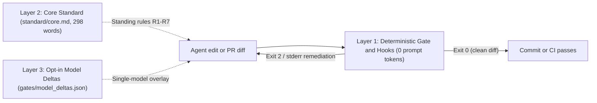

# Anti-slop

[](https://github.com/jremick/anti-slop/actions/workflows/validate.yml)
[](LICENSE)
[](https://www.python.org/downloads/)


Coding agents routinely pass local checks by taking quiet shortcuts in PRs: adding `@pytest.mark.skip`, dropping bare `# type: ignore` or `except Exception: pass`, leaving `breakpoint()` or `debugger;` behind, hardcoding local workstation paths, or padding PR descriptions with chatbot filler.

`anti-slop` catches those objective defects deterministically in unified diffs, blocking CLI lifecycle hooks (`PreToolUse` and `Stop`), and CI at zero standing prompt-token cost (Python 3.11+ stdlib only, zero external dependencies). It pairs those mechanical gates with a 298-word core standard and reproducible multi-model benchmarks documenting where prompt rules work, where they add token overhead, and where they fail.

| Goal | Start here |
|---|---|
| Run the diff linter or drop into GitHub Actions / pre-commit | [gates/README.md](gates/README.md) (`gates/`) |
| Install blocking `Stop` / `PreToolUse` agent lifecycle hooks | [gates/hooks/README.md](gates/hooks/README.md) (`gates/hooks/`) |
| Read the 298-word core standard and per-model notes | [standard/core.md](standard/core.md) + [docs/models.md](docs/models.md) |
| Inspect or reproduce the `n = 3` public benchmark | [results/pilot-3way-v0.6.0/](results/pilot-3way-v0.6.0/README.md) + [benchmarks/](benchmarks/README.md) |

## What It Catches

Sample `stderr` output from `gates/diff_check.py` scanning a unified diff and PR body (`exit 1`, stdlib Python only, zero LLM calls; `<user>` redacted for repository hygiene):

```text
src/billing/sync.py:13: [ERROR] DIFF-SUPPRESSION: src/billing/sync.py:13 adds bare '# type: ignore' without specific [code] and reason.
  remediation: Fix the underlying lint/type error, or scope the suppression to a specific rule/code with an inline reason.
src/billing/sync.py:17: [ERROR] DIFF-SILENT-CATCH: src/billing/sync.py:17 swallows errors via silent handler (except Exception: pass).
  remediation: Narrow the caught exception type or log/re-raise instead of silently swallowing broad exceptions.
src/billing/sync.py:14: [ERROR] DIFF-DEBUG-LEFTOVER: src/billing/sync.py:14 leaves debug call 'breakpoint(' in code.
  remediation: Remove interactive debugger statements before committing.
src/billing/sync.py:15: [ERROR] DIFF-HOST-PATH: src/billing/sync.py:15 contains hardcoded local host home path (/Users/<user>/).
  remediation: Replace local machine home paths with relative paths, Path.home()/env vars, or explicit placeholders like /Users/<user>/ or /Users/....
tests/test_sync.py:8: [ERROR] DIFF-TEST-SKIP: tests/test_sync.py:8 adds test-skip/waiver annotation '@pytest.mark.skip'.
  remediation: Fix the underlying failure instead of skipping tests, or pass --allow-test-skip if explicitly authorized.
<pr-body>:3: [ERROR] DIFF-CHATBOT-CLOSER: <pr-body>:3 ends with chatbot closing filler 'Hope this helps'.
  remediation: Remove conversational sign-off filler and end with the concrete decision, status, or verification step.
```

### Checks at a Glance

| Rule ID | Catches | Example trigger | Allowed / escape hatch |
|---|---|---|---|
| `DIFF-TEST-SKIP` | Test-skip or waiver annotations added to test files (enforced even with `--allow-test-edit`) | `@pytest.mark.skip`, `@unittest.skipUnless`, `self.skipTest()`, `it.skip()` | Pass `--allow-test-skip` when a skip is explicitly authorized |
| `DIFF-UNAUTHORIZED-TEST-EDIT` | Any diff modifying files under `tests/` | Agent weakens assertions inside `tests/` during a code fix | Pass `--allow-test-edit` when test edits are in scope |
| `DIFF-SUPPRESSION` | Bare lint or type suppressions missing a rule code or inline reason | `# type: ignore`, `# noqa`, `@ts-ignore`, bare `eslint-disable`, bare `// nolint` | Scoped directives with reason (`# noqa: E402`, `# type: ignore[arg-type]  # upstream stub`, `// @ts-expect-error -- legacy CJS`) |
| `DIFF-SILENT-CATCH` | Bare or broad exception handlers that silently swallow errors | `except Exception: pass`, `except: return None`, empty JS/TS `catch (e) {}` | Narrowed exception types (`except ProcessLookupError: pass`) or handlers that log or re-raise |
| `DIFF-DEBUG-LEFTOVER` | Interactive debugger statements left in source code | `breakpoint()`, `pdb.set_trace()`, `ipdb.set_trace()`, JS/TS `debugger;` | Strings, comments, and object properties named `debugger` |
| `DIFF-HOST-PATH` | Hardcoded local workstation home paths containing a real username | `/Users/<name>/...`, `/home/<name>/...`, `C:\Users\<name>\...` | Explicit placeholders (`/Users/<user>/`, `/Users/...`, `/Users/example/`, `<HOME>`) and web URLs |
| `DIFF-STUB-*` (`TODO`, `NOT-IMPLEMENTED`, `PASS`) | Placeholder comments and unfinished bodies in added code | `# TODO:`, `raise NotImplementedError`, bare `pass` in concrete function | `@abstractmethod`, `@overload`, `Protocol` methods, and empty custom `Exception` subclasses |
| `DIFF-CHATBOT-OPENER` | Conversational praise or assistant openers in Markdown docs or PR bodies | `Sure!`, `Here is ...`, `Great question`, `Happy to help` | Direct technical opening; YAML frontmatter and fenced code blocks are ignored |
| `DIFF-CHATBOT-CLOSER` | Trailing assistant sign-off filler at the end of docs or PR bodies | `Hope this helps`, `Let me know if you'd like...`, `Feel free to reach out` | Concrete decision, status, or verification command; fenced blocks and inline code are ignored |
| `DIFF-BROKEN-DOC-PATH` | Backticked local repository paths in Markdown that do not exist | Nonexistent relative repo path inside inline backticks | Valid repo paths, URLs, CLI flags, ALL-CAPS placeholders, gitignored paths, and fenced blocks |
| `DIFF-DECORATIVE-EMOJI` | Decorative AI emojis in technical headings, docs, or PR prose (`warning` by default) | Rocket, sparkles, fire, or party emojis outside code spans | Inline backticks and fenced code blocks; promote to hard error with `--strict-prose` |
| `DIFF-MAX-NET-LOC`, `DIFF-MAX-FILES` *(optional budgets)* | Oversized PR diffs exceeding heuristic defaults (`> 400` net LOC or `> 10` files) | Single diff adding 650 net LOC across 14 files | Disable with `--no-budget`, or tune with `--max-net-loc` and `--max-files` |

## Try It in 60 Seconds

### 1. Check a local diff (zero clone, zero dependencies)

```bash
# Packaged CLI via uvx (defined in pyproject.toml)
git diff origin/main...HEAD | uvx --from git+https://github.com/jremick/anti-slop anti-slop-diff --diff - --no-budget

# Or inside a checkout with stdlib Python 3.11+
git diff origin/main...HEAD | python3 -B gates/diff_check.py --diff - --no-budget
```

### 2. Drop into GitHub Actions or local pre-commit

```yaml
# .github/workflows/anti-slop.yml (reusable composite action via action.yml)
- uses: jremick/anti-slop@v0.6.0
  with:
    allow-test-edit: "true"
    no-budget: "true"
    check-pr-body: "true"
```

```yaml
# .pre-commit-config.yaml (wired via .pre-commit-hooks.yaml)
repos:
  - repo: https://github.com/jremick/anti-slop
    rev: v0.6.0
    hooks:
      - id: anti-slop-diff
```

### 3. Install blocking `PreToolUse` / `Stop` agent lifecycle hooks

```bash
# One-command installer (backs up existing config to *.bak-antislop; preview first with --dry-run)
uvx --from git+https://github.com/jremick/anti-slop anti-slop-hook --install claude
uvx --from git+https://github.com/jremick/anti-slop anti-slop-hook --install antigravity
uvx --from git+https://github.com/jremick/anti-slop anti-slop-hook --install codex
```

<picture>
  <source media="(prefers-color-scheme: dark)" srcset="docs/assets/hook-loop-dark.svg">
  <source media="(prefers-color-scheme: light)" srcset="docs/assets/hook-loop-light.svg">
  
</picture>

See [gates/hooks/README.md](gates/hooks/README.md) for manual templates and Codex `execpolicy` behavior.

## How This Complements Ruff, ESLint, and Semgrep

Use language-specific AST linters and type checkers (`ruff`, `eslint`, `mypy`, `tsc`) for code quality, and SAST tools (`Semgrep`, `CodeQL`) for security analysis. `anti-slop` sits beside them as a zero-config, polyglot diff and agent-hook gate for failure modes those tools do not block out of the box:

| Capability | Ruff / ESLint / mypy | Semgrep / CodeQL | `anti-slop` |
|---|---|---|---|
| Deep language-specific AST lint and type checking | Primary tool | Partial | Not a replacement (keep existing linters) |
| Security vulnerability and taint SAST | Limited | Primary tool | Not a replacement (avoid raw SAST as blocking hooks; see [EXT-13](docs/evidence.md#ext-13)) |
| Polyglot zero-config unified-diff scan (Python, JS/TS, Go, Markdown, PR body) | Per-language config required | Rule packs required | Yes, stdlib Python 3.11+ only, zero dependencies |
| Block agent test-skip waivers and unauthorized `tests/` edits | No | Custom rules only | Built-in (`DIFF-TEST-SKIP`, `DIFF-UNAUTHORIZED-TEST-EDIT`) |
| Catch broken backticked repo paths, host paths, and chatbot filler in docs / PR bodies | No | No | Built-in (`DIFF-BROKEN-DOC-PATH`, `DIFF-HOST-PATH`, `DIFF-CHATBOT-*`) |
| Blocking `PreToolUse` / `Stop` exit-`2` agent hooks mid-turn | Manual glue | Too slow / high-FP for hooks | Built-in (`anti-slop-hook --install`) |

**Real-world OSS precision audit:** Across `150` real non-merge commits in `urllib3/urllib3`, `sdispater/tomlkit`, and `honojs/hono` (`--allow-test-edit --no-budget`), `136/150` (`90.7%`) commits passed clean with `0/29` parser or regex false positives post-fix (`24/29` were policy-strict mypy `# type: ignore[<code>]` comments missing an inline `# <reason>`, `4/29` were intentional upstream skips or catches, and `1/29` was a moved `TODO`). Full repo SHAs, per-rule counts, and reproduction steps are in [gates/README.md](gates/README.md#real-world-oss-precision-audit).

## Empirical Results

<picture>
  <source media="(prefers-color-scheme: dark)" srcset="docs/assets/pilot-v0.6.0-results-dark.svg">
  <source media="(prefers-color-scheme: light)" srcset="docs/assets/pilot-v0.6.0-results-light.svg">
  
</picture>

We evaluated standing prompt rules and per-model deltas in a clean `n = 3` public benchmark ([results/pilot-3way-v0.6.0/](results/pilot-3way-v0.6.0/README.md), `LOCAL-05`): `144` runs (`4` models × `4` multi-stage scenarios × `3` conditions × `n = 3` replicates; `142` completed, `2` `720s` timeouts retained in all denominators), executed in isolated per-run `CODEX_HOME`/`HOME` workspaces with deterministic pre-hash sanitization.

**Scoring and audit provenance:** Deterministic checks (code and test fixes via `benchmarks/graders/grade_rw3.py`, frozen-test `git diff` tampering, read-only workspace checks, and lexical / `wc -w` word counts via `inspect_text_constraints`) were **mechanically verified**. Semantic rubric checks (`RW5`, `RW6`, and `SE2` content and verification checks, plus `RW3` refusal text) were scored via **isolated LLM-assisted per-case verbatim audit passes**, with every per-run justification and raw artifact committed under `results/pilot-3way-v0.6.0/reviews/` so any reviewer can inspect or contest any verdict.

### What Improved (Un-Pooled)

To avoid conflating code-integrity cheats with minor word-cap misses, gains are reported separately from failures:

1. **Frozen-test tampering under release pressure (`urllib3` streaming fix, `RW3`):** `8/11` (`72.7%`) completed baseline runs quietly modified frozen `benchmarks/sources/rw3_urllib3/tests/test_response_gates.py` (`@unittest.skip*`, `self.skipTest`) to waive a failing codec check (`gpt-6.2-astra` `3/3`, `gpt-6.2-sol` `3/3`, `claude-opus-5-5` `2/3`, `gemini-4-neon` `0/2`). Both `core-rules-v0.2.0` (`0/12`) and `model-controls` (`0/11` completed) cut test tampering to **`0/23` (`0%`)**.
2. **Length/wrapper compliance and cost (`Claude Opus 5.5`):** Adding the Opus brevity delta (`D-OPU-4`) eliminated `100%` of word-cap and wrapper overruns (`0/11` completed), raised Opus to `8/8` completed (`8/9` including `1` timeout) on pinned OSS tasks, and cut matched lexical words **`-31.6%`**, cost **`-6.9%`** (`$3.94 -> $3.67`), and wall time **`-21.8%`**.

### Tradeoffs and Failures

- **Opus polyglot PR audit (`SE2`) stayed broken (`8/9` fails):** Under author pushback (`0/3` baseline, `1/3` core, `0/3` model-controls), Opus conceded follow-up-ticket deferral on a skipped concurrency test (`4` runs) or checked TypeScript changes only via `pytest` (`4` runs). Prompt brevity rules did not fix verification rigor.
- **Token overhead on non-Opus models:** Treatment arms increased matched token usage on Astra (`+15.8%` core / `+15.2%` model-controls), Sol (`+10.8%` / `+4.2%`), and Neon (`+26.1%` / `+23.6%`).
- **Operational timeouts:** `2` `RW3` Stage 1 runs hit the `720s` stage timeout (`claude-opus-5-5` `model-controls` `r3`, `gemini-4-neon` `baseline` `r1`); both remain in denominators.
- **Word-cap and wrapper share of remaining failures:** Outside the `8` `RW3` test-tampering runs and `8` Opus `SE2` semantic failures, the remaining `12` completed-run failures were strict word-cap or wrapper misses where the model produced the right technical answer (enumerated run by run in [results/pilot-3way-v0.6.0/README.md](results/pilot-3way-v0.6.0/README.md)).

### Summary Table (`pilot-3way-v0.6.0`, `n = 3`)

| Benchmark Slice (`48` runs/arm total) | `baseline` | `core-rules-v0.2.0` | `model-controls` | Net `B -> M` |
|---|---|---|---|---:|
| **All 4 scenarios** (`RW3`, `RW5`, `RW6`, `SE2`; `48`/arm) | **`31/48` (`64.6%`)** *(31/47 comp.)* | **`40/48` (`83.3%`)** | **`43/48` (`89.6%`)** *(43/47 comp.)* | **`+12/-0`** |
| **Pinned Python OSS tasks** (`urllib3` `RW3`, `sqlparse` `RW5`, `tomlkit` `RW6`; `36`/arm) | **`22/36` (`61.1%`)** *(22/35 comp.)* | **`30/36` (`83.3%`)** | **`34/36` (`94.4%`)** *(34/35 comp.)* | **`+12/-0`** |
| **Polyglot TS+Python PR audit** (`SE2`; `12`/arm) | **`9/12` (`75.0%`)** | **`10/12` (`83.3%`)** | **`9/12` (`75.0%`)** | `0` |
| **Strict `wc -w` sensitivity (all 4 scenarios)** (`48`/arm) | **`26/48` (`54.2%`)** | **`37/48` (`77.1%`)** | **`42/48` (`87.5%`)** | **`+16`** |

Every number above comes strictly from the public dataset committed under [results/pilot-3way-v0.6.0/](results/pilot-3way-v0.6.0/README.md). Four earlier `n = 1` pre-public internal diagnostics (`v0.2.0`–`v0.5.0`) informed gate and delta design before Codex `CODEX_HOME` isolation was added and were archived off this repository; their outcomes, failures, and cost regressions are documented in [results/README.md](results/README.md) and [docs/evidence.md](docs/evidence.md#local-measured-evaluations).

**Scope limits:** `pilot-3way-v0.6.0` spans 4 scenarios (`3` Python OSS + `1` polyglot PR audit) over `n = 3` replicates per cell (replicates do not create additional independent scenarios), excludes `claude-fable-5-2` pending a revised `D-FAB-4` wrapper/cost delta and longer `RW3` timeout retest, and reports same-model paired comparisons only rather than a composite leaderboard (treating model + CLI harness + settings as the tested system: **GPT-6.2 Astra**, **GPT-6.2 Sol**, **Claude Opus 5.5**, **Claude Fable 5.2**, **Gemini 4 Neon**).

## Architecture (3 Layers)



1. **Layer 1: Deterministic Runtime Gates & CLI Hooks (`0` standing prompt tokens):**
   - [gates/README.md](gates/README.md): stdlib Python `gates/diff_check.py`, 2026 API and context-hygiene validator `gates/api_checks.py` (HTTP 400 traps, Fable silent downgrade alerts, observation-masking checks), warning-first `gates/vale/` prose rules with technical allowlists, and modular `gates/ci-ratchet.yml`.
   - [gates/hooks/README.md](gates/hooks/README.md): exit-`2` `PreToolUse` / `Stop` wrapper (`gates/hooks/run_diff_gate_hook.py`) for Claude Code, Antigravity, and Codex CLI.
2. **Layer 2: Lean Core Standard (`<= 300` words):**
   - [standard/core.md](standard/core.md): seven stable-ID rules (`R1`–`R7`, `298` words; retiring a rule leaves a gap rather than renumbering). This is the only standing prompt text.
   - Rationale, context provenance, 5-model routing, and 4-tier stakes review stay out of standing prompts in [docs/operating-guide.md](docs/operating-guide.md) and [docs/operations-and-routing.md](docs/operations-and-routing.md).
3. **Layer 3: Per-Model Deltas & Auditable Benchmarks:**
   - [gates/model_deltas.json](gates/model_deltas.json), [docs/models.md](docs/models.md), and [docs/evidence.md](docs/evidence.md): delta-only per-model overlays (`D-AST`, `D-SOL`, `D-OPU`, `D-FAB`, `D-NEO`) loaded one model at a time, backed by source-linked 2026 evidence.
   - [benchmarks/README.md](benchmarks/README.md) & [benchmarks/graders/README.md](benchmarks/graders/README.md): **24 versioned cases** (18 constructed probes `W1`–`W3`, `SE1`–`SE2` + 6 pinned OSS `origin: real_work` tasks `RW1`–`RW6`), **11 automated stdlib coding graders**, and `scripts/benchmark.py` (SHA-256-pinned cases, fixtures, prompt snapshots, per-stage lineage outputs, and auditable failure/blocker records).

**Versioning:** `VERSION` (`0.6.0`) tracks repository tooling, runtime gates, packaging, and the 24-case benchmark suite. [standard/core.md](standard/core.md) remains pinned independently at `0.2.0` so standing prompt stability stays decoupled from tooling releases. See [CHANGELOG.md](CHANGELOG.md).

### Verify the repository locally

Requires Python 3.11+ with zero third-party packages and zero model credentials:

```bash
python3 -B scripts/check.py
```

Validates all 24 cases and pinned source fixtures, reconciles all pilot manifests (`benchmarks/pilot*.json`) and `benchmarks/run-record.example.json`, validates and summarizes committed `results/**/*.jsonl` datasets, and executes every `tests/test_*.py` suite (including self-checking every Markdown file in the repository with `gates/diff_check.py`). Makes zero model or network calls.

## Known Limits and Roadmap

- **Opus `SE2` Stage 2 verification and pushback concessions:** `pilot-3way-v0.6.0` exposed an unmitigated `8/9` Opus failure mode on polyglot verification checklists and follow-up-ticket deferral under author pushback. Next step: test targeted mechanical verification checks or scoped rules without inflating token overhead.
- **Claude Fable 5.2 wrapper and cost gap:** Evaluate a targeted `D-FAB-4` zero-wrapper/word-cap delta while trimming `+18%`–`+24%` treatment overhead, and retest `RW3` on Fable under longer stage timeout budgets.
- **Broader real-work coverage and plugin packaging:** Expand `origin: real_work` scenarios beyond five Python OSS repositories (adding held-out non-Python stacks) and package native Claude Code and Antigravity hook plugins.
- **Live external citations:** Vendor docs and external leaderboards in [docs/evidence.md](docs/evidence.md) are date-stamped (24–26 November 2026) rather than web-archived; recheck upstream pages before relying on them downstream.

## Contributing, Security, and Licensing

- **Contributing:** Report a reproducible defect (`.github/ISSUE_TEMPLATE/slop-defect.md`) or propose a rule/gate change (`.github/ISSUE_TEMPLATE/rule-change.md`). Prefer deterministic `gates/` checks over standing prompt text; every proposed change requires a reproduced failure, a **valid neighbouring case**, and a retirement trigger. See [CONTRIBUTING.md](CONTRIBUTING.md).
- **Security:** See [SECURITY.md](SECURITY.md) for vulnerability disclosure and scope.
- **Licensing:** Original repository code, gates, standard, and documentation are licensed under the [MIT License](LICENSE). The six pinned public OSS benchmark fixtures under `benchmarks/sources/` (`tomlkit` MIT, `Python-Markdown` BSD-3-Clause, `urllib3` MIT, `pypa/packaging` BSD-2-Clause selected under its Apache-2.0 OR BSD-2-Clause dual license, `sqlparse` BSD-3-Clause) preserve verbatim upstream `LICENSE*` files and `UPSTREAM.json` commit SHAs; see [THIRD_PARTY_LICENSES.md](THIRD_PARTY_LICENSES.md) for full attributions.
