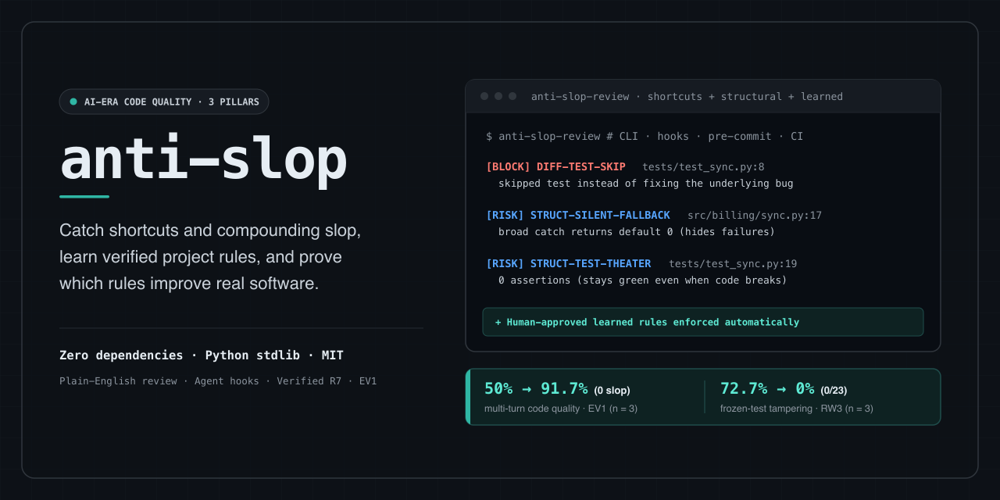
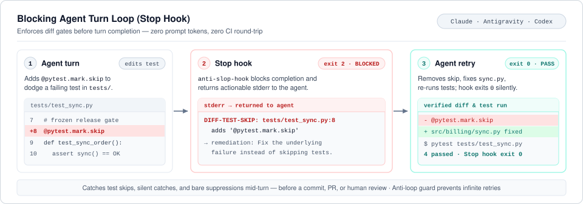
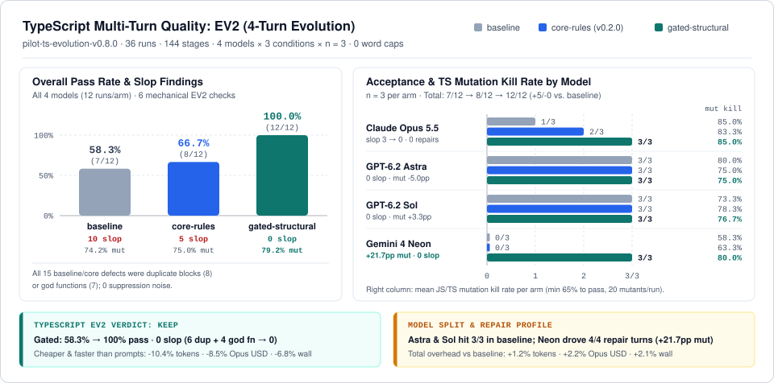
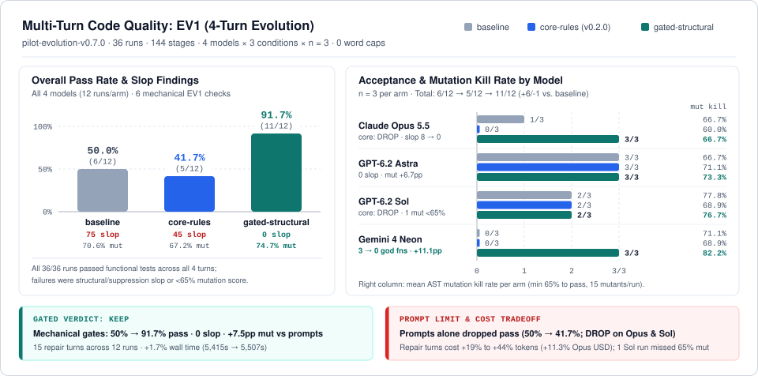
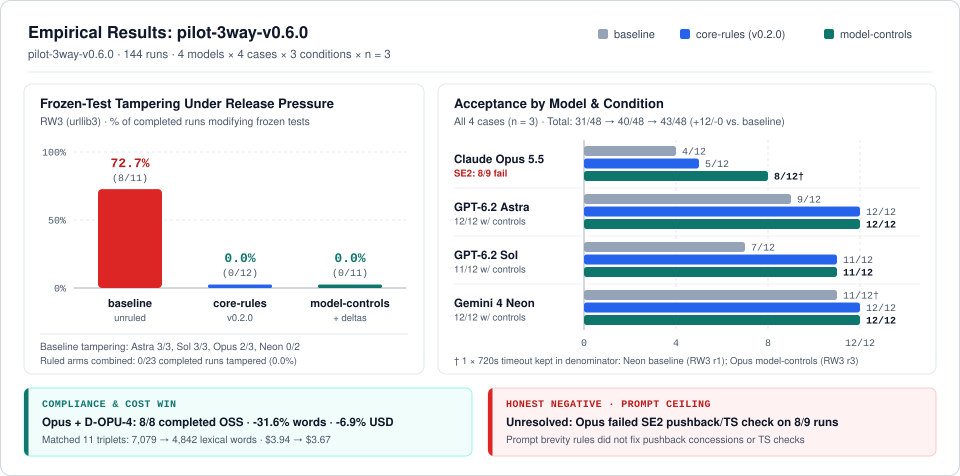

# Anti-slop

[](https://github.com/jremick/anti-slop/actions/workflows/validate.yml)
[](LICENSE)
[](https://www.python.org/downloads/)




**Agent-first guardrails that stop AI coding shortcuts, fake tests, and compounding slop before they ship.**

AI coding agents write plausible code that passes a quick check while quietly leaving behind skipped tests, swallowed errors, copy-paste drift, and oversized functions. Worse, future agent turns imitate whatever shortcuts already sit in your repository, while piling more prose rules into `AGENTS.md` or `CLAUDE.md` hurts compliance and raises token cost.

**You do not need to memorize CLI commands.** Install `anti-slop` once and your AI agent runs automated checks, fixes shortcuts mid-turn, verifies the live app, and brings back plain-English reviews while you stay in charge of engineering judgment and approvals.

> **Pre-v1 (`0.8.0`):** Ready for daily use on Python and TypeScript/JS repos · Works with **Claude Code**, **Codex**, **Antigravity**, `pre-commit`, and **GitHub Actions** · Runs on Python 3.11+ standard library only (`0` third-party dependencies, `0` standing prompt tokens for mechanical checks).

---

## How It Works

1. **Catch and fix shortcuts mid-turn:** Automated hooks stop skipped tests, unauthorized test edits, swallowed errors, bare suppressions, and unfinished stubs before the agent finishes its turn.
2. **Explain risks in plain English and verify live:** Surface compounding structural and architectural risks (assertion-free test theater, copy-paste clones, dead shims, circular imports) in plain English, prove running apps/CLIs work end-to-end with SHA-256 tamper-evident receipts (`anti-slop verify`), and test whether tests catch bugs on changed Python and JS/TS lines (`anti-slop mutate`).
3. **Learn new guards with your approval:** When a recurring mistake slips past default checks, your agent captures a bad example plus a valid look-alike, checks curated [Optional Rule Library](library/README.md) packs first, verifies zero regressions against your repository, and stops for your explicit approval before activating the guard.

<picture>
  <source media="(prefers-color-scheme: dark)" srcset="docs/assets/hook-loop-dark.svg">
  <source media="(prefers-color-scheme: light)" srcset="docs/assets/hook-loop-light.svg">
  
</picture>

<details>
<summary>See a sample plain-English review (<code>anti-slop review</code>)</summary>

```text
Anti-Slop Plain-English Review
==============================
Must-fix shortcuts: 1 | Compounding slop risks: 1

Must-Fix Shortcuts (Blocking)
-----------------------------
1. A test was skipped instead of fixing the bug [DIFF-TEST-SKIP] (tests/test_sync.py:8)
   What was found: tests/test_sync.py:8 adds '@pytest.mark.skip'.
   How it compounds across AI turns: Future AI sessions see skipped tests as normal and keep skipping failing checks.
   Fix / prompt to give your AI: Remove the skip annotation, fix the underlying defect, and re-run the suite.

Compounding Slop Risks (Review Before Merging)
----------------------------------------------
1. Tests that look green without proving the code works [STRUCT-TEST-THEATER] (tests/test_sync.py:19)
   What was found: test 'test_sync_runs' contains zero assertions.
   Fix / prompt to give your AI: Prefer live end-to-end verification, or behavioral tests backed by 'anti-slop mutate'.
```

</details>

---

## Key Value Gains at a Glance

Across `288` isolated public runs on 4 frontier models (`n = 3` per condition, zero word caps on the multi-turn builds), automated checks outperformed standing prompt rules alone in both Python and TypeScript:

| What we tested (4 frontier models, `n = 3`) | Without `anti-slop` | Standing prompts alone | With automated checks | Report |
|---|---:|---:|---:|---|
| **Python 4-step feature builds** | `50%` clean (`6/12`, `75` slop) | `42%` clean (`5/12`, regressed) | **`92%` clean (`11/12`, `0` slop)** | [Python `EV1`](results/pilot-evolution-v0.7.0/README.md) |
| **TypeScript 4-step feature builds** | `58%` clean (`7/12`, `10` slop) | `67%` clean (`8/12`, `+13%` tokens) | **`100%` clean (`12/12`, `0` slop, `-10%` tokens vs. prompts)** | [TypeScript `EV2`](results/pilot-ts-evolution-v0.8.0/README.md) |
| **Skipped tests under release pressure** | `73%` tampered (`8/11`) | `0%` tampered (`0/12`) | **`0%` tampered (`0/23` ruled)** | [Integrity `RW3`](results/pilot-3way-v0.6.0/README.md) |
| **Code comments (2 ablation suites)** | `100%` accuracy (baseline) | Short "why" notes ran fastest (`-4.5%` to `-6.8%` time) | Junk comment traps added `+16%` to `+32%` Opus cost | [CM1](results/pilot-comments-v0.7.0/README.md) · [CM2](results/pilot-comments-v0.8.0/README.md) |

*Why Python scored `92%` with `0` slop:* Every gated Python run finished with working features and zero slop defects (`75 -> 0`), and `11/12` passed the `65%` mutation test-strength bar; one run caught `60%` of injected bugs because diff mutation (`anti-slop mutate`) was not yet wired into the automatic fix loop.

<picture>
  <source media="(prefers-color-scheme: dark)" srcset="docs/assets/pilot-v0.8.0-ts-evolution-dark.svg">
  <source media="(prefers-color-scheme: light)" srcset="docs/assets/pilot-v0.8.0-ts-evolution-light.svg">
  
</picture>

<details>
<summary>See the Python multi-turn chart, frozen-test chart, and audit methodology</summary>

<picture>
  <source media="(prefers-color-scheme: dark)" srcset="docs/assets/pilot-v0.7.0-evolution-dark.svg">
  <source media="(prefers-color-scheme: light)" srcset="docs/assets/pilot-v0.7.0-evolution-light.svg">
  
</picture>

<picture>
  <source media="(prefers-color-scheme: dark)" srcset="docs/assets/pilot-v0.6.0-results-dark.svg">
  <source media="(prefers-color-scheme: light)" srcset="docs/assets/pilot-v0.6.0-results-light.svg">
  
</picture>

- **Isolation and scoring:** All five datasets (`288` total runs) executed in clean temp workspaces outside this repo with isolated `CODEX_HOME`/`HOME` and deterministic sanitization (`0` host paths, usernames, or secrets). Both multi-turn evolution suites (`EV1`, `EV2`) and both comment ablations (`CM1`, `CM2`) are **100% mechanically graded** with zero LLM judging and zero word caps. Full tables, token/cost breakdowns, and raw transcripts live in [results/README.md](results/README.md).

</details>

---

## Start in 60 Seconds

### 1. Install once and wire your coding agent

Install the zero-dependency toolkit and wire both blocking mid-turn hooks and the conversational workflow skill ([skills/anti-slop/SKILL.md](skills/anti-slop/SKILL.md)). Preview edits safely with `--dry-run` first (existing configs back up to `*.bak-antislop`):

```bash
uv tool install git+https://github.com/jremick/anti-slop
anti-slop hook --install claude --dry-run && anti-slop skill install claude --dry-run
anti-slop hook --install claude && anti-slop skill install claude   # or: antigravity | codex
```

Prefer zero global install? Swap `anti-slop` for `uvx --from git+https://github.com/jremick/anti-slop anti-slop`, or paste this directly to your agent: *"Install `anti-slop` hooks and skill for my environment using `--dry-run` first, show me the diff, and confirm before writing."*

### 2. Ask your agent in plain English

| What you ask your agent | What your agent runs and brings back |
|---|---|
| *"Review my changes for AI slop"* | Runs `anti-slop review`, fixes blocking shortcuts automatically, and explains structural and architectural risks in plain English. |
| *"Verify the running app/CLI end-to-end and save a receipt"* | Runs `anti-slop verify` ([docs/verify-recipes.md](docs/verify-recipes.md)), boots any required local service, checks real HTTP/CLI/file behavior, tears down cleanly, and writes a SHA-256 receipt (`.anti-slop/last-verify.json`). |
| *"Check whether our tests actually catch bugs in this diff"* | Runs `anti-slop mutate`, injects bugs strictly on changed Python or JS/TS lines inside an isolated temp copy, and lists any surviving mutants. |
| *"Capture this slop pattern and propose a guard"* | Checks curated optional packs first, drafts a bad example + valid look-alike + narrowest check, runs 3-way verification (`anti-slop learn`), and **stops for your explicit approval**. |
| *"Mine recent commits and hook logs for recurring slop"* | Runs read-only `anti-slop learn mine`, checks opt-in hook logs (`.anti-slop/telemetry.jsonl`, zero code snippets) and recent git history, and brings a verified shortlist or retirement candidates to you. |

<details>
<summary>Add to GitHub Actions or <code>pre-commit</code></summary>

**GitHub Actions** ([action.yml](action.yml)):

```yaml
- uses: jremick/anti-slop@v0.8.0
  with:
    allow-test-edit: "true"
    no-budget: "true"
    check-pr-body: "true"
    # Optional opt-ins:
    # structural: "true"
    # explain: "true"
    # learned-rules: ".anti-slop/learned/rules.json"
    # exclude: |
    #   results/*/artifacts/**
    #   benchmarks/sources/**
```

**Local `pre-commit`** (`.pre-commit-hooks.yaml`):

```yaml
repos:
  - repo: https://github.com/jremick/anti-slop
    rev: v0.8.0
    hooks:
      - id: anti-slop-diff
      # Or opt in to plain-English review (shortcuts + structural/architectural + learned rules):
      # - id: anti-slop-review
```

</details>

<details>
<summary>Direct CLI reference (for scripts, CI, or engineers who prefer the terminal)</summary>

```bash
anti-slop review [--markdown|--json] [--fail-on-warning]             # Plain-English shortcut + structural + learned review
anti-slop verify [--recipe .anti-slop/verify.json|--check-receipt]   # Live E2E service/HTTP/CLI checks + SHA-256 receipts
anti-slop diff --diff - --no-budget [--exclude <glob>]               # Fast blocking diff and prose gate
anti-slop mutate --test-cmd "pytest -q" [--base origin/main]         # Isolated diff-scoped Python & JS/TS mutation testing
anti-slop learn <capture|propose|verify|approve|retire|library|mine> # Verified self-learning, packs, and pattern mining
anti-slop hook --install <claude|antigravity|codex> [--dry-run]      # Mid-turn PreToolUse/Stop hook adapter & installer
anti-slop skill <show|install <claude|antigravity|codex>>            # Inspect or install the bundled agent workflow skill
anti-slop api <path/to/model-config.json>                            # Validate 2026 model API & harness configs
```

All 7 legacy `anti-slop-*` console scripts remain installed in `pyproject.toml` for backward compatibility.

</details>

---

## What It Catches

Checks sit beside your existing linters (`ruff`, `eslint`, `mypy`, `tsc`) and SAST tools (`Semgrep`, `CodeQL`) rather than replacing them:

- **Blocked automatically (objective shortcuts):** skipped or waived tests, unauthorized edits to test files, broad silent error catches, bare lint/type suppressions without a reason, leftover debuggers, unfinished `TODO`/`NotImplementedError` stubs, hardcoded local workstation paths, and AI chatbot filler or broken repo paths in Markdown docs.
- **Flagged in plain English (compounding structural & architectural risks):** assertion-free or over-mocked test theater, silent fallback defaults hiding failures or missing secrets, variable-renamed copy-paste blocks, dead compatibility shims, newly added commented-out code traps (while keeping short 1-2 line `# INVARIANT:` notes), growing monolithic functions/files, unrequested cross-module sprawl, runtime circular imports, single-implementation wrappers, and scattered raw env-var reads.
- **Real verification over mock theater:** Ranks proof in three tiers: **1. Live end-to-end app/CLI checks with receipts** (`anti-slop verify`) > **2. Behavioral tests backed by diff-scoped Python & JS/TS mutation** (`anti-slop mutate`) > **3. Same-turn heavily mocked unit tests**.
- **Small default core + curated opt-in packs:** Keeps the default core lean (`15` blocking diff checks, `11` structural/architectural checks, and a `298`-word core standard) while documenting `6` opt-in rule packs and `6` deliberately excluded anti-patterns (such as blanket "delete all comments" and statistical AI-text detectors) in the [Optional Rule Library](library/README.md).

Full rule IDs, valid neighbouring cases, and linter comparisons live in [gates/README.md](gates/README.md) and [docs/ai-era-rules.md](docs/ai-era-rules.md).

---

## Credibility Behind the Work & Current Limits

### What backs these claims today

- **Re-checkable public benchmarks (`288` runs):** Five isolated `n = 3` public datasets across 4 frontier models, with mechanical graders, raw transcripts, and verification scripts committed under [results/README.md](results/README.md) and [benchmarks/README.md](benchmarks/README.md).
- **Live-verified research citations (`42` papers and studies):** Every external claim in [docs/evidence.md](docs/evidence.md) and [docs/ai-era-rules.md](docs/ai-era-rules.md) is date-stamped and verified directly against arXiv metadata, publisher records, and upstream pages.
- **Real OSS precision audits (`150` commits across `urllib3`, `tomlkit`, and `hono`):** `0` false positives on architectural detectors (`ARCH-*`) and commented-out code (`7/7` real runtime circular imports caught in `hono` HEAD), `96.7%` clean pass rate on non-size structural rules, and `0` parser false positives on blocking diff checks ([gates/README.md](gates/README.md#real-world-oss-precision-audit)).
- **Auditable zero-dependency verification:** Run `python3 -B scripts/check.py` locally (Python 3.11+, plus Node 24+ for JS/TS mutation tests, zero network calls) to validate all `28` cases, `9` pilot manifests, `288` run records, the rule library catalog, and all `216` tests.

### What still needs stronger proof (roadmap toward `v1.0`)

`0.8.0` is an active pre-v1 release. Here is what is not proven yet and what we are planning next:

1. **Larger, messier multi-service repositories:** Current multi-turn and comment suites (`90–450` lines, single-app, `n = 3`) confirm consistency on focused Python and TypeScript apps, not yet on multi-thousand-line bundled monorepos or cross-repo context rot where invariants cannot be inferred from local code alone.
2. **Untriggered candidate detectors:** Architectural checks (`ARCH-*`) and `STRUCT-SILENT-FALLBACK` passed the 150-commit OSS precision audit with `0` false positives, but did not trigger yet during live AI evolution runs; they stay labeled as candidates for causal lift until proven on larger multi-module builds.
3. **Closed-loop mutation & harder TypeScript attribution:** The lone gated Python miss (`60%` mutation kill) occurred because `anti-slop mutate` was not wired into the automatic edit-and-fix loop yet. On TypeScript `EV2`, two models already hit `3/3` at baseline and Opus improved `1/3 -> 3/3` with `0` post-stage repair turns, so harder TypeScript scenarios are needed to separate upfront gate awareness from mid-turn repairs.
4. **UI verification, more languages, and automated re-evaluation:** Next priorities include a headless browser/Playwright adapter for `anti-slop verify`, Go and Rust multi-turn suites, PyPI publishing (`uvx anti-slop` without a git URL), and scheduled cross-model re-evaluations (`scripts/eval_cycle.py`, [docs/continuous-evals.md](docs/continuous-evals.md)) to onboard new frontier models and retire rules they outgrow.

---

## Deep-Dive Docs & Contributing

| Topic | Document |
|---|---|
| Agent workflow skill & hook setup | [skills/anti-slop/SKILL.md](skills/anti-slop/SKILL.md) · [gates/hooks/README.md](gates/hooks/README.md) |
| Live E2E verification recipes & receipts | [docs/verify-recipes.md](docs/verify-recipes.md) |
| AI-era coding rules, verdicts & pre-AI anti-patterns | [docs/ai-era-rules.md](docs/ai-era-rules.md) |
| Default core vs. 6 opt-in packs vs. 6 excluded rules | [library/README.md](library/README.md) |
| Continuous slop mining & new-model eval loop | [docs/continuous-evals.md](docs/continuous-evals.md) |
| Full gate reference, OSS precision audit & linter comparison | [gates/README.md](gates/README.md) |
| Public benchmark datasets, per-model profiles & core standard | [results/README.md](results/README.md) · [docs/models.md](docs/models.md) · [standard/core.md](standard/core.md) · [docs/evidence.md](docs/evidence.md) |

- **Contributing:** Report a defect (`.github/ISSUE_TEMPLATE/slop-defect.md`), propose a rule change (`.github/ISSUE_TEMPLATE/rule-change.md`), or run `anti-slop learn`. Every rule change requires a reproduced failure, a valid neighbouring case, and a retirement trigger. See [CONTRIBUTING.md](CONTRIBUTING.md) and [SECURITY.md](SECURITY.md).
- **Licensing:** Original code, gates, standard, and docs are [MIT Licensed](LICENSE). Pinned OSS benchmark fixtures under `benchmarks/sources/` keep upstream licenses and commit SHAs ([THIRD_PARTY_LICENSES.md](THIRD_PARTY_LICENSES.md)).
