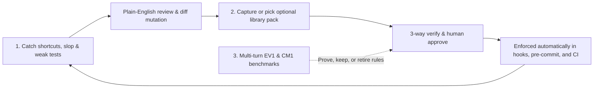

# Anti-slop

[](https://github.com/jremick/anti-slop/actions/workflows/validate.yml)
[](LICENSE)
[](https://www.python.org/downloads/)


AI coding tools often produce code that looks convincing and passes a quick run while quietly accumulating hidden defects: skipped or over-mocked tests that stay green when features break ([Hora & Robbes, arXiv:2602.00409](https://arxiv.org/abs/2602.00409), [EXT-13](docs/evidence.md#ext-13)), silent fallback defaults or bare type suppressions, copy-pasted logic that drifts across files ([GitClear 2025](https://www.gitclear.com/ai_assistant_code_quality_2025_research), [EXT-12](docs/evidence.md#ext-12)), commented-out code traps ([Huang et al., arXiv:2512.20334](https://arxiv.org/abs/2512.20334), [EXT-14](docs/evidence.md#ext-14)), and growing monolithic functions ([Liu et al., arXiv:2603.28592](https://arxiv.org/abs/2603.28592); [Zhu et al., arXiv:2605.02741](https://arxiv.org/abs/2605.02741), [EXT-15](docs/evidence.md#ext-15)).

Worse, **slop compounds across future AI sessions**. Coding agents imitate whatever patterns already sit in your repository ([Sun et al., ETH Zurich, arXiv:2611.11455](https://arxiv.org/abs/2611.11455), [EXT-12](docs/evidence.md#ext-12)), while piling more prose rules into `AGENTS.md` or `CLAUDE.md` degrades compliance and raises inference cost ([IFScale, arXiv:2507.11538](https://arxiv.org/abs/2507.11538); [Gloaguen et al., arXiv:2602.11988](https://arxiv.org/abs/2602.11988), [EXT-11](docs/evidence.md#ext-11)). In our live 4-turn evolution benchmark below (`EV1`, 36 runs), standing prose rules alone **regressed** overall pass rate (`50.0% -> 41.7%`), whereas mechanical diff and structural gates lifted pass rate to **`91.7%` (`11/12`, `0` slop defects)** and raised AST mutation kill rate **`+7.5pp`** over standing prompts.

`anti-slop` is a zero-dependency Python 3.11+ toolkit built around three pillars:

1. **Catch shortcuts and compounding slop with plain-English review & diff-scoped mutation:** block objective shortcuts mid-turn or in CI, catch structural decay and commented-out code traps before they spread, verify test strength on changed lines with `anti-slop-mutate`, and explain in plain English why engineers flag each pattern and what fix prompt to give your AI.
2. **Learn from what slips through (verified, human-approved, plus a curated optional rule library):** capture a bad example and a valid look-alike case, choose the smallest prevention (deterministic check first, codebase example second, short rule last), verify it automatically against your repo, activate it only after human approval, or opt into curated rule packs via `anti-slop-learn library`.
3. **Prove which rules improve real software:** benchmark rules against multi-turn feature evolution (`EV1`: functional bugs, AST mutation kill rate, duplicate blocks, dead shims, god functions, silent shortcuts; zero word caps) and controlled comment ablations (`CM1`), keeping what works and retiring what does not.



| What you want to do | Start here |
|---|---|
| Understand which coding rules earned `KEEP` in `EV1` (and which pre-AI habits hurt) | [AI-Era Coding Rules Guide](docs/ai-era-rules.md) |
| Run a plain-English review of your current git changes | `python3 -B gates/review.py` ([gates/README.md](gates/README.md)) |
| Check whether your tests catch real bugs on your changed Python lines | `anti-slop-mutate --test-cmd "pytest -q"` ([gates/mutate.py](gates/mutate.py)) |
| Browse Default Core vs. 6 Opt-In Rule Packs vs. 6 Deliberately Excluded rules | [Optional Rule Library](library/README.md) (`anti-slop-learn library list`) |
| Run the fast blocking diff gate in CLI, GitHub Actions, or pre-commit | `gates/diff_check.py` ([gates/README.md](gates/README.md)) |
| Block AI shortcuts and enforce approved learned rules mid-turn | `gates/hooks/run_diff_gate_hook.py` ([gates/hooks/README.md](gates/hooks/README.md)) |
| Capture, verify, approve, or retire a custom project rule | `gates/learn.py` ([docs/operating-guide.md](docs/operating-guide.md)) |
| Inspect live public datasets (`EV1`, `CM1`, `v0.6.0`) and per-model profiles | [results/README.md](results/README.md) + [docs/models.md](docs/models.md) + [standard/core.md](standard/core.md) |

---

## Try It in 60 Seconds

Everything runs on Python 3.11+ standard library only (zero third-party installs, zero LLM API calls, zero standing prompt-token cost for mechanical gates).

### 1. Get a plain-English review of your current changes

```bash
# Review your current git diff (shortcuts + compounding slop + approved learned rules)
python3 -B gates/review.py

# Or via uvx without cloning the repo
uvx --from git+https://github.com/jremick/anti-slop anti-slop-review

# Markdown output (ready to paste into a PR comment or AI chat)
python3 -B gates/review.py --markdown
```

Sample plain-English output:

```text
Anti-Slop Plain-English Review
==============================
Must-fix shortcuts: 1 | Compounding slop risks: 2

Must-Fix Shortcuts (Blocking)
-----------------------------
1. A test was skipped instead of fixing the bug [DIFF-TEST-SKIP] (tests/test_sync.py:8)
   What was found: tests/test_sync.py:8 adds test-skip/waiver annotation '@pytest.mark.skip'.
   Why engineers flag this: Adding a skip marker makes the test suite report green without verifying the broken behavior.
   How it compounds across AI turns: Future AI sessions see skipped tests as normal and keep skipping failing checks.
   Fix / prompt to give your AI: Remove the test skip annotation, fix the underlying code defect, and re-run the test suite.
   Reference: docs/evidence.md#local-05, docs/evidence.md#ext-13, docs/ai-era-rules.md

Compounding Slop Risks (Review Before Merging)
----------------------------------------------
1. Tests that look green without actually proving the code works [STRUCT-TEST-THEATER] (tests/test_sync.py:19)
   What was found: tests/test_sync.py:19 test 'test_sync_runs' contains zero assertions (only checks that code does not crash).
   Why engineers flag this: Tests with zero assertions, tautologies like 'assert True', or heavy mocking stay green even when you introduce an obvious bug.
   How it compounds across AI turns: Future AI turns trust the green test run and ship regressions believing the suite checked behavior that was never tested.
   Fix / prompt to give your AI: Prefer live end-to-end verification, or behavioral tests against real inputs backed by 'anti-slop-mutate', over mock-heavy unit tests.
   Reference: docs/evidence.md#ext-13, docs/ai-era-rules.md
```

### 2. Verify test strength on changed lines (`anti-slop-mutate`) & the 3-tier verification hierarchy

Coding agents edit tests almost twice as often as humans (`23%` vs. `13%`) and add mocks more often (`36%` vs. `26%`; [Hora & Robbes, arXiv:2602.00409](https://arxiv.org/abs/2602.00409), [EXT-13](docs/evidence.md#ext-13)). Vanilla LLM unit tests average ~`53%` mutation kill rate, and even `100%`-coverage suites can score `4%` on mutants ([MutGen, arXiv:2506.02954](https://arxiv.org/abs/2506.02954), [EXT-13](docs/evidence.md#ext-13)). Inspired by Google Critique diff-based mutation with arid-node suppression ([Petrović et al., arXiv:2102.11378](https://arxiv.org/abs/2102.11378), [EXT-13](docs/evidence.md#ext-13)), `anti-slop-mutate` injects stdlib AST mutations strictly on your changed executable Python lines inside an isolated temporary copy (never touching your working tree):

```bash
# Check whether your test suite kills real bugs injected on your changed Python lines
anti-slop-mutate --test-cmd "pytest -q"

# Or without cloning via uvx (pass --base origin/main or --files path.py:10-45 as needed)
uvx --from git+https://github.com/jremick/anti-slop anti-slop-mutate --test-cmd "pytest -q"
```

Treat verification evidence in three tiers (see [docs/ai-era-rules.md](docs/ai-era-rules.md#2-tests-and-verification-follow-the-3-tier-ai-era-verification-hierarchy)):

1. **Tier 1 (Strongest for apps, APIs, CLIs, UIs): Live end-to-end / real-artifact proof** (run the real process against real inputs and verify observable output or state).
2. **Tier 2 (Strong for logic and libraries): Behavioral integration/property tests + diff-scoped AST mutation (`anti-slop-mutate`)** against real code without mocking the system under test.
3. **Tier 3 (Weakest): Same-turn isolated, heavily mocked unit tests** (useful for narrow external I/O boundaries only; weak proof on their own).

### 3. Browse & enable opt-in packs from the Optional Rule Library

Default checks stay small on purpose so teams do not inherit noisy rules or prompt bloat. [library/README.md](library/README.md) ([library/catalog.json](library/catalog.json)) lays out all three buckets cleanly:

- **Default Core:** `15` Layer A `DIFF-*` checks, `8` Layer B `STRUCT-*` checks, and `standard/core.md` (`R1`-`R7`, `298` words).
- **6 Curated Opt-In Packs (`10` `OPT-*` rules):** `network-timeouts`, `security-boundaries`, `comment-hygiene`, `verification-proof`, `build-config-hygiene`, and `architecture-simplicity`.
- **6 Deliberately Excluded Items (`EXCL-*`):** statistical AI-text detectors (`61.22%` non-native English FP), unfiltered SAST as blocking post-edit hooks (`65%`/`61%` ground-truth match), blanket "delete all comments", blanket "be concise" prompts, 100% line-coverage mandates, and heavyweight upfront DI wrappers.

```bash
# List packs, inspect bad example + valid neighbour + evidence, and enable via 3-way verification
anti-slop-learn library list
anti-slop-learn library show network-timeouts
anti-slop-learn library enable network-timeouts --by <your-name> --dry-run
anti-slop-learn library enable network-timeouts --by <your-name>
```

Every `library enable` call runs the full 3-way `verify_rule()` gate (must catch `bad_example`, `0` hits on `valid_neighbouring_case`, `<= --max-repo-hits` on your existing repo) and leaves `<repo>/.anti-slop/learned/rules.json` untouched if verification fails.

### 4. Run the blocking diff gate in CI, pre-commit, or mid-turn agent hooks

```bash
# Fast objective-defect gate on a diff (add --structural --explain for compounding slop + plain-English rationale)
git diff origin/main...HEAD | python3 -B gates/diff_check.py --diff - --no-budget --structural --explain

# Install blocking mid-turn agent hooks (backs up existing config to *.bak-antislop; preview first with --dry-run)
uvx --from git+https://github.com/jremick/anti-slop anti-slop-hook --install claude --dry-run
uvx --from git+https://github.com/jremick/anti-slop anti-slop-hook --install antigravity --dry-run
uvx --from git+https://github.com/jremick/anti-slop anti-slop-hook --install codex --dry-run
```

GitHub Actions (reusable composite action via [action.yml](action.yml); opt-in `structural`, `strict-structural`, `explain`, and `learned-rules` inputs default off for backward compatibility):

```yaml
- uses: jremick/anti-slop@v0.6.0
  with:
    allow-test-edit: "true"
    no-budget: "true"
    check-pr-body: "true"
    # Optional opt-ins:
    # structural: "true"
    # explain: "true"
    # learned-rules: ".anti-slop/learned/rules.json"
```

Local `pre-commit` (wired via `.pre-commit-hooks.yaml`; choose fast `anti-slop-diff`, strict `anti-slop-diff-lock-tests`, or plain-English `anti-slop-review`):

```yaml
repos:
  - repo: https://github.com/jremick/anti-slop
    rev: v0.6.0
    hooks:
      - id: anti-slop-diff
      # Or opt in to plain-English review (shortcuts + structural risks + approved learned rules):
      # - id: anti-slop-review
```

<picture>
  <source media="(prefers-color-scheme: dark)" srcset="docs/assets/hook-loop-dark.svg">
  <source media="(prefers-color-scheme: light)" srcset="docs/assets/hook-loop-light.svg">
  
</picture>

When a repository contains an approved `<repo>/.anti-slop/learned/rules.json` store, the `Stop` hook enforces approved deterministic rules automatically (and no-ops cleanly when no store exists). See [gates/hooks/README.md](gates/hooks/README.md) for manual templates and Codex `execpolicy` behavior.

### 5. Turn a slipped project mistake into a verified, human-approved guard

```bash
# 1) Capture what slipped through + what should be allowed instead
python3 -B gates/learn.py capture \
  --title "Float math on money amounts" \
  --bad-code "total = float(cents) / 100.0" \
  --desired "Keep currency math in integer cents or Decimal." \
  --valid-code "seconds = float(elapsed_ms) / 1000.0"

# 2) Propose the narrowest prevention (deterministic check first, codebase example second, prompt rule last)
python3 -B gates/learn.py propose L-001 \
  --layer deterministic_check --severity error \
  --pattern '\bfloat\s*\(\s*\w*(?:cent|dollar|price|amount)\w*\s*\)' \
  --remediation "Use integer cents or Decimal for currency math." \
  --retirement-trigger "Retire once static NewType(Cents) enforces integer-only math."

# 3) Automatically verify against (a) bad case, (b) valid look-alike, and (c) existing repo files
python3 -B gates/learn.py verify L-001

# 4) Explicitly approve as a human (unverified or edited rules fail closed and never run)
python3 -B gates/learn.py approve L-001 --by maintainer

# 5) Later, when models or linters make it obsolete, retire cleanly (preserves L-001 gap + examples)
python3 -B gates/learn.py retire L-001 --reason "Superseded by static Cents typing."
```

Approved deterministic rules are enforced automatically by `gates/review.py`, the live `Stop` hook in `gates/hooks/run_diff_gate_hook.py`, `gates/diff_check.py --learned-rules <store>`, and opt-in `learned-rules` in `action.yml`.

---

## What It Catches

Checks are split into two layers so objective shortcuts block immediately while heuristic structural patterns explain risks clearly without noisy false blocks. For concrete before/after examples, measured verdicts, and pre-AI habits that hurt AI workflows, read [AI-Era Coding Rules](docs/ai-era-rules.md).

### Layer A: Objective Shortcuts (Blocked by default in `diff_check.py` and hooks)

| Rule ID | Catches | Example trigger | Allowed / escape hatch |
|---|---|---|---|
| `DIFF-TEST-SKIP` | Test-skip or waiver annotations added to test files (enforced even with `--allow-test-edit`) | `@pytest.mark.skip`, `@unittest.skipUnless`, `self.skipTest()`, `it.skip()` | Pass `--allow-test-skip` when a skip is explicitly authorized |
| `DIFF-UNAUTHORIZED-TEST-EDIT` | Any diff modifying files under `tests/` | Agent weakens assertions inside `tests/` during a code fix | Pass `--allow-test-edit` when test edits are in scope |
| `DIFF-SUPPRESSION` | Bare lint or type suppressions missing a rule code or inline reason | `# type: ignore`, `# noqa`, `@ts-ignore`, bare `eslint-disable`, bare `// nolint` | Scoped directives with reason (`# noqa: E402`, `# type: ignore[arg-type]  # upstream stub`, `// @ts-expect-error -- legacy CJS`) |
| `DIFF-SILENT-CATCH` | Bare or broad exception handlers that silently swallow errors | `except Exception: pass`, `except: return None`, empty JS/TS `catch (e) {}` | Narrowed exception types (`except ProcessLookupError: pass`) or handlers that log or re-raise |
| `DIFF-DEBUG-LEFTOVER` | Interactive debugger statements left in source code | `breakpoint()`, `pdb.set_trace()`, `ipdb.set_trace()`, JS/TS `debugger;` | Strings, comments, and object properties named `debugger` |
| `DIFF-HOST-PATH` | Hardcoded local workstation home paths containing a real username | `/Users/<name>/...`, `/home/<name>/...`, `C:\Users\<name>\...` | Explicit placeholders (`/Users/<user>/`, `/Users/...`, `/Users/example/`, `<HOME>`) and web URLs |
| `DIFF-STUB-*` (`TODO`, `NOT-IMPLEMENTED`, `PASS`) | Placeholder comments and unfinished bodies in added code | `# TODO:`, `raise NotImplementedError`, bare `pass` in concrete function | `@abstractmethod`, `@overload`, `Protocol` methods, and empty custom `Exception` subclasses |
| `DIFF-CHATBOT-OPENER` / `DIFF-CHATBOT-CLOSER` | Conversational openers or sign-offs in Markdown docs or PR bodies | `Sure!`, `Here is ...`, `Hope this helps`, `Let me know if you'd like...` | Direct technical opening and concrete closing status; code fences and inline backticks ignored |
| `DIFF-BROKEN-DOC-PATH` | Backticked local repository paths in Markdown that do not exist | Nonexistent relative repo path inside inline backticks | Valid repo paths, URLs, CLI flags, ALL-CAPS placeholders, gitignored paths, and fenced blocks |
| `DIFF-DECORATIVE-EMOJI` | Decorative AI emojis in technical headings, docs, or PR prose (`warning` by default) | Rocket, sparkles, fire, or party emojis outside code spans | Inline backticks and fenced code blocks; promote to hard error with `--strict-prose` |
| `DIFF-MAX-NET-LOC`, `DIFF-MAX-FILES` *(optional budgets)* | Oversized diffs exceeding defaults (`> 400` net LOC or `> 10` files) | Single diff adding 650 net LOC across 14 files | Disable with `--no-budget`, or tune with `--max-net-loc` and `--max-files` |

### Layer B: Compounding Structural Slop (`anti-slop-review` and `diff_check.py --structural`)

Default `warning` (promote to blocking errors with `--strict-structural`):

| Rule ID | Plain-English meaning | What it detects | Valid neighbouring case (allowed) |
|---|---|---|---|
| `STRUCT-TEST-THEATER` | Tests that stay green even when code breaks | Python/JS/TS tests with zero assertions, tautologies (`assert True`, `assert x == x`, `expect(true).toBe(true)`), or `>= 3` mocks with zero real value/state assertions | Normal assertions, `pytest.raises`, `warnings.simplefilter("error", ...)`, `expectTypeOf`/`assertType`, AST-verified test helpers, or `<= 2` mocks with real output assertions |
| `STRUCT-SILENT-FALLBACK` | Made-up defaults hiding broken logic or missing secrets | Broad `except Exception:` returning a silent literal (`0`, `"unknown"`, `""`) without logging/re-raising; JS/TS `catch (e) { return 0; }`; hardcoded fallback strings on sensitive env vars (`*SECRET*`, `*API_KEY*`, `*TOKEN*`, `*PASSWORD*`) | Narrowed catches (`except KeyError: return 0`), logged broad catches, non-secret env defaults (`LOG_LEVEL`) |
| `STRUCT-DUPLICATE-BLOCK` | Copy-pasted logic that will drift out of sync | Alpha-normalized Python AST clones (`>= 6` statements with real control flow/ops, catching variable-renamed copy-paste) and normalized JS/TS/Go blocks duplicated across production files or functions | Short helpers, flat constant blocks, test setup fixtures |
| `STRUCT-DEAD-COMPAT` | Dead branches and abandoned "legacy" shims | Unreachable `if False:` / `if 0:` branches, unreferenced `*_legacy`/`*_compat`/`*_deprecated` symbols, `allow_legacy_*` flags, and orphaned private module helpers never called anywhere | Live private helpers called in-module, decorated handlers, active adapters with callers |
| `STRUCT-COMMENTED-CODE` | Commented-out code traps poisoning future AI turns (`0` FPs across 150 OSS commits + 551 HEAD files; [Huang et al., arXiv:2512.20334](https://arxiv.org/abs/2512.20334), [EXT-14](docs/evidence.md#ext-14)) | Newly added `>= 3`-line consecutive executable-looking commented-out code blocks in Python (AST-verified), JS/TS, and Go | Short 1-2 line `# INVARIANT:` / "why" notes ([Vitale et al., arXiv:2601.23059](https://arxiv.org/abs/2601.23059)), docstrings, JSDoc `@example`, fenced comment examples, license headers, URLs, and dividers |
| `STRUCT-GOD-FUNCTION` / `STRUCT-GOD-FILE` | Growing monolithic functions or files | Functions exceeding `60` code lines or `12` branches `[Heuristic]`; production files growing above `400` code lines `[Heuristic]` | Focused helpers, or refactoring diffs that **shrink** an existing large file |
| `STRUCT-SCOPE-SPRAWL` | Unrequested edits scattered across unrelated modules | Single diff editing `> 3` distinct production module directories `[Heuristic]` | Focused feature touching one production module plus `tests/` and `docs/` |

---

## Verified Self-Learning Loop (`R7` in Practice)

Standing prompt rules bloat quickly if every one-off mistake becomes another line in `AGENTS.md` or `CLAUDE.md` ([IFScale, arXiv:2507.11538](https://arxiv.org/abs/2507.11538); [Gloaguen et al., arXiv:2602.11988](https://arxiv.org/abs/2602.11988), [EXT-11](docs/evidence.md#ext-11)). `gates/learn.py` (`anti-slop-learn`) implements `R7` as an auditable workflow:

1. **Catch & Capture (or Browse Library):** Record the slipped bad code, desired outcome, and a **valid neighbouring case** that an overbroad rule could accidentally break (assigns a permanent ID `L-001`, `L-002`, ...), or select a curated pack from [library/README.md](library/README.md) (`anti-slop-learn library list|show|enable`).
2. **Smallest Prevention Ladder:** `suggest` and `propose` enforce narrowest-scope-first:
   - `deterministic_check` (first choice: regex/pattern check at zero prompt tokens),
   - `codebase_example` (second choice: point to a canonical repo helper/file),
   - `prompt_rule` (last resort: capped at `<= 45` words, requires explicit `--why-not-deterministic` justification and a `--retirement-trigger`).
3. **3-Way Automated Verification (`verify`):** For deterministic checks, verifies (a) the bad example is caught, (b) the valid neighbouring case has `0` hits, and (c) scanning your existing repository produces `<= --max-repo-hits` (default `0`) false positives.
4. **Human Approval Gate (`approve`):** Only rules with `status == "verified"` can be approved, bound to a SHA-256 hash of the verified proposal. Editing the rules store after approval invalidates the hash and fails closed (rule is ignored until re-verified and re-approved).
5. **Clean Retirement (`retire`):** Stops enforcing the rule while preserving its captured regression examples and leaving its ID permanently unused (never renumbered or reused).

---

## Empirical Evidence: Live Multi-Turn Code Quality, Comment Ablation, and `v0.6.0`

All three public datasets under [results/](results/README.md) (`216` total runs across 4 frontier models, `n = 3` replicates per cell) executed in isolated temp workspaces outside this repository with per-run isolated `CODEX_HOME`/`HOME` and deterministic pre-hash sanitization (`0` workstation paths, `0` usernames, `0` secrets).

### 1. Multi-Turn Compounding Software Quality (`EV1`, 36 runs, 144 stages, 0 word caps)

Full report and raw artifacts: [results/pilot-evolution-v0.7.0/README.md](results/pilot-evolution-v0.7.0/README.md) ([LOCAL-07](docs/evidence.md#local-07)).

<picture>
  <source media="(prefers-color-scheme: dark)" srcset="docs/assets/pilot-v0.7.0-evolution-dark.svg">
  <source media="(prefers-color-scheme: light)" srcset="docs/assets/pilot-v0.7.0-evolution-light.svg">
  
</picture>

Across 4 sequential turns on the same evolving Python billing/ledger codebase ([benchmarks/cases/EV1.json](benchmarks/cases/EV1.json); `36/36` completed, `144/144` base stages functional pass, 100% mechanically graded by [benchmarks/graders/grade_ev1.py](benchmarks/graders/grade_ev1.py)):

| Condition Arm (`12` runs/arm) | Overall Pass | Functional (`4` turns) | AST Mutation Kill Mean / Med | Total Slop Defects (`/run`) | God Fns | Silent / Shortcuts | Test Theater | Stage 1-4 Wall Time |
|---|---:|---:|---:|---:|---:|---:|---:|---:|
| `baseline` | **`6/12` (`50.0%`)** | `12/12` | `70.56%` / `66.67%` | `75` (`6.25`) | `3` | `71` | `1` | `5,415.0s` (`+0.0%`) |
| `core-rules-v0.2.0` (prompts alone) | **`5/12` (`41.7%`)** | `12/12` | `67.22%` / `63.33%` | `45` (`3.75`) | `3` | `42` | `0` | `5,161.0s` (`-4.7%`) |
| `gated-structural` (mechanical gates) | **`11/12` (`91.7%`)** | `12/12` | **`74.72%` / `73.33%`** | **`0` (`0.00`)** | **`0`** | **`0`** | **`0`** | `5,506.8s` (`+1.7%`) |

Key measured findings and tradeoffs:

1. **Mechanical gates outperformed standing prompts alone (`91.7%` vs. `41.7%`):** Standing prose instructions (`core-rules-v0.2.0`) **regressed** overall pass rate (`6/12 -> 5/12`, `+1/-2`) and weakened mean mutation kill rate (`70.6% -> 67.2%`), scoring **`DROP`** in `benchmarks/evolution.py compare` on both `claude-opus-5-5` (`1/3 -> 0/3`, `66.7% -> 60.0%` mut) and `gpt-6.2-sol` (`77.8% -> 68.9%` mut). Running mechanical diff + structural checks (`gated-structural`, zero standing prompt bloat) jumped pass rate to **`11/12` (`91.7%`)** (`+6/-1` vs. baseline, `+6/-0` vs. prompts), eliminated **`75 -> 0`** slop findings, and lifted AST mutation kill rate **`+7.5pp`** vs. prompts (`+4.2pp` vs. baseline), earning **`KEEP`** aggregate and on 3 of 4 models (Opus `1/3 -> 3/3`, Astra `3/3` [`+6.7pp` mut], Neon `0/3 -> 3/3`).
2. **Mid-evolution structural and test-theater catches:** On `gemini-4-neon`, `gated-structural` caught `upgrade_subscription` (`69L-70L`) at Stage 2 across `3/3` replicates (`STRUCT-GOD-FUNCTION`), cutting Neon god functions **`3/3 -> 0/3`** (`maxFnL 75L -> 49L`) and lifting Neon mutation kill rate from `71.1%` / `68.9%` to **`82.2%`**. On `claude-opus-5-5`, `gated-structural` caught an assertion-free smoke test (`STRUCT-TEST-THEATER`, `test_percent_bounds_are_inclusive`) at Stage 2 `r3` (`1 -> 0`). Across all 12 `gated-structural` runs, pre-repair findings comprised `15` `DIFF-SUPPRESSION`, `10` `STRUCT-DEAD-COMPAT` (preventing `legacy_flat_fee` from leaking into Stage-2 helpers before Turn 4 deprecated it), `5` `STRUCT-GOD-FUNCTION`, and `1` `STRUCT-TEST-THEATER`.
3. **Defect composition, token overhead, and lone miss:** All `113/113` `silent_failures_and_shortcuts` defects in `baseline` (`71`) and `core-rules-v0.2.0` (`42`) were bare `# type: ignore[...]` comments lacking inline reasons (`0` broad silent `except`, `0` test skips, `0` stubs, `0` duplicate blocks, `0` Stage-4 legacy shims). The `15` automated gate-repair turns kept Stage 1-4 wall time nearly flat (`+1.7%`) while adding **`+18.7%` to `+43.8%` total tokens** across models (`+11.3%` Opus USD, `$5.34 -> $5.95`). The sole remaining `gated-structural` failure (`gpt-6.2-sol r1`, `60.0% < 65%` mutation kill, `0` slop) happened because `anti-slop-mutate` was not yet wired into the Stage 1-4 gate loop.

### 2. Controlled Comment-Hygiene Ablation (`CM1`, 36 runs)

Full report and raw artifacts: [results/pilot-comments-v0.7.0/README.md](results/pilot-comments-v0.7.0/README.md) ([LOCAL-06](docs/evidence.md#local-06)).

Testing identical-AST Python webhook files (`webhooks.py`) across 4 models x 3 arms x `n = 3` (`36/36` completed, 100% mechanically graded by [benchmarks/graders/grade_cm1.py](benchmarks/graders/grade_cm1.py); motivated by [Huang et al., arXiv:2512.20334](https://arxiv.org/abs/2512.20334) and [Vitale et al., arXiv:2601.23059](https://arxiv.org/abs/2601.23059), [EXT-14](docs/evidence.md#ext-14)):

| Condition Arm (`12` runs/arm) | Pass (`4` checks) | Aggregate Wall Time (vs. `no-comments`) | Opus USD (vs. `no-comments`) | Comment Diff Churn |
|---|---:|---:|---:|---|
| `no-comments` (`0` comments, `90L`) | `12/12` (`100.0%`) | `413.0s` (`+0.0%`) | `$0.4022` (`+0.0%`) | `+0 / -0` on `12/12` |
| `invariant-comments` (`3` `# INVARIANT:` lines, `93L`) | `12/12` (`100.0%`) | **`394.3s` (`-4.5%`)** | **`$0.3953` (`-1.7%`)** | `+0 / -0` (all `3` preserved verbatim on `12/12`) |
| `comment-traps` (`28` comment lines incl. dead float blocks + stale claim, `119L`) | `12/12` (`100.0%`) | **`523.5s` (`+26.8%`; `+32.8%` vs. invariant)** | **`$0.5288` (`+31.5%`)** | `-28` comment lines scrubbed on `12/12` |

All 4 frontier models hit a `12/12` accuracy ceiling (`INCONCLUSIVE` on pass rate) because `CM1` is a single 90-line module whose prompt explicitly names the ordering, cent-math, and dead-code invariants. Even at `100%` accuracy, `comment-traps` was the slowest arm on **4/4 models** (`+26.8%` to `+32.8%` wall time, `+31.5%` Opus USD, `-28` forced deletions), while 3 short `# INVARIANT:` notes ran `-4.5%` faster (`-1.7%` Opus USD) with zero accidental removals.

### 3. Frozen-Test Integrity & Per-Model Overlays (`pilot-3way-v0.6.0`, 144 runs)

Full report and per-run verbatim reviews: [results/pilot-3way-v0.6.0/README.md](results/pilot-3way-v0.6.0/README.md) ([LOCAL-05](docs/evidence.md#local-05)).

<picture>
  <source media="(prefers-color-scheme: dark)" srcset="docs/assets/pilot-v0.6.0-results-dark.svg">
  <source media="(prefers-color-scheme: light)" srcset="docs/assets/pilot-v0.6.0-results-light.svg">
  
</picture>

Across 4 frontier models, 4 real-world OSS and PR-audit tasks, and `n = 3` runs per cell (`144` runs total, `142` completed + `2` `720s` timeouts kept in denominators):

1. **Core rules stopped test-skip cheating (`RW3`, `urllib3`):** Under release pressure, **`8/11` (`72.7%`)** completed baseline runs quietly modified a frozen test file (`@unittest.skip*`, `self.skipTest`) to waive a failing check (`Astra` `3/3`, `Sol` `3/3`, `Opus` `2/3`, `Neon` `0/2`). Standing `core-rules-v0.2.0` cut tampering to **`0/12` (`0%`)**, and `model-controls` stayed at **`0/11` (`0%`)**.
2. **`model-controls` tied `core-rules` on 3 of 4 models:** On `GPT-6.2 Astra` (`12/12` vs `12/12`), `GPT-6.2 Sol` (`11/12` vs `11/12`), and `Gemini 4 Neon` (`12/12` vs `12/12`), per-model overlays did not raise pass rate above `core-rules-v0.2.0` while adding matched token overhead (`+15.8%`/`+15.2%` Astra, `+10.8%`/`+4.2%` Sol, `+26.1%`/`+23.6%` Neon). Per-model overlays only moved pass rate on **`Claude Opus 5.5`** (`5/12 -> 8/12`; `8/8` completed OSS) via `D-OPU-4`, eliminating word-cap/wrapper overruns (`0/11`) while cutting matched lexical words **`-31.6%`**, USD **`-6.9%`** (`$3.94 -> $3.67`), and wall time **`-21.8%`**.
3. **Why `v0.6.0` motivated shifting to `EV1`:** Prompt rules still failed `8/9` Opus `SE2` Stage 2 runs (deferral concessions or `pytest`-only TS verification), and outside `RW3` test tampering and Opus `SE2`, the remaining `12` completed-run failures were word-cap/wrapper misses rather than multi-turn structural code decay. That gap motivated building and running `EV1` above.

| Benchmark Slice (`48` runs/arm total) | `baseline` | `core-rules-v0.2.0` | `model-controls` | Net `B -> M` |
|---|---|---|---|---:|
| **All 4 scenarios** (`RW3`, `RW5`, `RW6`, `SE2`; `48`/arm) | **`31/48` (`64.6%`)** *(31/47 comp.)* | **`40/48` (`83.3%`)** | **`43/48` (`89.6%`)** *(43/47 comp.)* | **`+12/-0`** |
| **Pinned Python OSS tasks** (`urllib3` `RW3`, `sqlparse` `RW5`, `tomlkit` `RW6`; `36`/arm) | **`22/36` (`61.1%`)** *(22/35 comp.)* | **`30/36` (`83.3%`)** | **`34/36` (`94.4%`)** *(34/35 comp.)* | **`+12/-0`** |
| **Polyglot TS+Python PR audit** (`SE2`; `12`/arm) | **`9/12` (`75.0%`)** | **`10/12` (`83.3%`)** | **`9/12` (`75.0%`)** | `0` |
| **Strict `wc -w` sensitivity (all 4 scenarios)** (`48`/arm) | **`26/48` (`54.2%`)** | **`37/48` (`77.1%`)** | **`42/48` (`87.5%`)** | **`+16`** |

<details>
<summary>Audit methodology &amp; isolation details (<code>LOCAL-05</code>, <code>LOCAL-06</code>, <code>LOCAL-07</code>)</summary>

- **Isolation &amp; privacy:** All three published datasets executed under per-run isolated `CODEX_HOME`/`HOME` with deterministic pre-hash sanitization (`0` workstation paths, `0` usernames, `0` personal skills, `0` `.agy.log` files across all published files under `results/`).
- **Scoring split:** `LOCAL-06` (`CM1`, `benchmarks/graders/grade_cm1.py`) and `LOCAL-07` (`EV1`, `benchmarks/graders/grade_ev1.py`) are **100% mechanically graded** with zero LLM judging and zero word caps. In `LOCAL-05` (`pilot-3way-v0.6.0`), deterministic checks (`benchmarks/graders/grade_rw3.py`, frozen-test `git diff`, read-only checks, lexical/`wc -w` counts) were mechanically verified, while semantic rubric checks were scored via isolated per-case verbatim audit passes committed under `results/pilot-3way-v0.6.0/reviews/`.

</details>

---

## Technical Reference

### How This Complements Ruff, ESLint, and Semgrep

Keep language-specific AST linters (`ruff`, `eslint`, `mypy`, `tsc`) for deep single-language rules and SAST tools (`Semgrep`, `CodeQL`) for security taint analysis. `anti-slop` sits beside them as a zero-config, zero-dependency polyglot diff, structural-review, mutation, learning, and agent-hook layer:

| Capability | Ruff / ESLint / mypy | Semgrep / CodeQL | `anti-slop` |
|---|---|---|---|
| Deep single-language AST lint and type checking | Primary tool | Partial | Not a replacement (keep existing linters) |
| Security vulnerability and taint SAST | Limited | Primary tool | Not a replacement (avoid raw SAST as blocking hooks; see [EXT-13](docs/evidence.md#ext-13)) |
| Zero-config polyglot diff gate + blocking `PreToolUse`/`Stop` agent hooks | Per-stack config / manual glue | Rulepacks / too slow for hooks | Built-in (`anti-slop-diff`, `anti-slop-hook --install`) |
| Catch test-skip waivers, test theater, silent fallback defaults, variable-renamed duplicate clones, dead legacy shims, commented-out code traps, and plain-English review | Partial per-language only | Custom rules only | Built-in (`anti-slop-review`, `gates/structural.py`) |
| Diff-scoped Python AST mutation testing on changed lines | Not built in | Not built in | Built-in (`anti-slop-mutate`, isolated temp copy) |
| Human-gated, repo-verified self-learning rule loop + curated optional library | Manual rule authoring | Manual rule authoring | Built-in (`anti-slop-learn`, `library/catalog.json`, auto-enforced in `Stop` hook & `anti-slop-review`) |

**Real-world OSS precision audits (150 commits across `urllib3/urllib3`, `sdispater/tomlkit`, and `honojs/hono`):**

- **Layer A (`gates/diff_check.py`, `--allow-test-edit --no-budget`):** `136/150` (`90.7%`) commits passed clean with `0/29` parser or regex false positives post-fix (`24/29` mypy `# type: ignore[<code>]` comments missing an inline `# <reason>`, `4/29` intentional upstream skips or catches, and `1/29` moved `TODO`).
- **Layer B (`gates/structural.py`, warning-only default):** `145/150` (`96.7%`) commits passed clean on non-size structural defect rules (`STRUCT-SILENT-FALLBACK`: `0`, `STRUCT-DEAD-COMPAT`: `0`, `STRUCT-COMMENTED-CODE`: `0`, `STRUCT-SCOPE-SPRAWL`: `0`, `STRUCT-DUPLICATE-BLOCK`: `4` true mirrored-adapter duplicates in `hono`, `STRUCT-TEST-THEATER`: `3` no-assert/string-eval tests in `urllib3`), after fixing `3` parser/AST FP classes (`expectTypeOf`/`assertType`, AST-verified imported test helpers, and `warnings.simplefilter("error", ...)`). `STRUCT-COMMENTED-CODE` also recorded **`0` false positives across 551 OSS HEAD code files** (`331` multi-line comment groups) and across `anti-slop` itself. `65/72` total structural warnings came from growing pre-existing 518-to-1,951-line OSS files/methods, confirming why `STRUCT-*` defaults to `warning` unless `--strict-structural` is opted in. Full SHAs and reproduction steps are in [gates/README.md](gates/README.md#real-world-oss-precision-audit).

### Architecture

1. **Deterministic Gates, Plain-English Review, Diff Mutation, Self-Learning & CLI Hooks (`0` standing prompt tokens):**
   - Six console scripts in `pyproject.toml`: `gates/diff_check.py` (`anti-slop-diff`), `gates/review.py` (`anti-slop-review`), `gates/learn.py` (`anti-slop-learn`), `gates/mutate.py` (`anti-slop-mutate`), `gates/hooks/run_diff_gate_hook.py` (`anti-slop-hook`), and `gates/api_checks.py` (`anti-slop-api`), plus `gates/structural.py`, warning-first `gates/vale/`, `gates/ci-ratchet.yml`, and [library/README.md](library/README.md) (`library/catalog.json`). See [gates/README.md](gates/README.md).
2. **Lean Core Standard (`<= 300` words) & AI-Era Guidance:**
   - [standard/core.md](standard/core.md): seven stable-ID rules (`R1`-`R7`, `298` words, independently pinned at `0.2.0`; retiring a rule leaves a gap rather than renumbering). Rationale, measured AI-era rules vs. pre-AI anti-patterns, and operating workflows stay out of standing prompts in [docs/ai-era-rules.md](docs/ai-era-rules.md), [docs/operating-guide.md](docs/operating-guide.md), and [docs/operations-and-routing.md](docs/operations-and-routing.md).
3. **Per-Model Deltas & Auditable Benchmarks:**
   - [gates/model_deltas.json](gates/model_deltas.json), [docs/models.md](docs/models.md), [docs/evidence.md](docs/evidence.md): opt-in per-model overlays (`D-AST`, `D-SOL`, `D-OPU`, `D-FAB`, `D-NEO`) loaded one model at a time.
   - [benchmarks/README.md](benchmarks/README.md) & [benchmarks/graders/README.md](benchmarks/graders/README.md): **26 versioned cases** (`20` constructed including 4-turn `EV1` and `CM1` + `6` pinned OSS `origin: real_work` tasks `RW1`-`RW6`), **13 automated stdlib graders**, **7 pilot manifests**, `benchmarks/evolution.py`, `scripts/benchmark.py`, and **3 clean public datasets** (`216` total runs under [results/](results/README.md)).

### Verify the repository locally

Requires Python 3.11+ with zero third-party packages and zero model credentials:

```bash
python3 -B scripts/check.py
```

Validates all 26 versioned cases and pinned source fixtures, verifies `CM1` identical-AST ablation fixtures (`grade_cm1.py --check-ablation-fixtures`), validates `library/catalog.json`, reconciles all 7 pilot manifests (`benchmarks/pilot*.json`) and `benchmarks/run-record.example.json`, validates and summarizes all committed `results/**/*.jsonl` datasets (`216` runs across 9 paired tracks), and executes every `tests/test_*.py` suite (including self-checking authored Markdown files with `gates/diff_check.py`). Makes zero model or network calls.

### Known Limits and Roadmap

- **Single-scenario constructed scope in `EV1` & `CM1`:** `pilot-evolution-v0.7.0` and `pilot-comments-v0.7.0` establish consistent `n = 3` outcomes on stdlib Python scenarios, not arbitrary multi-language production repositories. Next benchmark steps: wire `anti-slop-mutate` into the optional gate loop (addressing the sole remaining `gpt-6.2-sol r1` `60.0%` mutation miss), add multi-language evolution chains, and design `CM2` with cross-file implicit invariants unnamed in the user prompt.
- **Untriggered `EV1` rules & practitioner hypotheses stay labeled as such:** `STRUCT-DUPLICATE-BLOCK` (`4` true hits in `hono` OSS audit) and `STRUCT-SILENT-FALLBACK` both had `0` triggers in `EV1`, and heuristics like premature single-use abstractions remain tagged `Practitioner hypothesis` in [docs/ai-era-rules.md](docs/ai-era-rules.md).
- **Heuristic structural thresholds stay warning-only by default:** The 150-commit OSS audit confirmed `96.7%` clean pass rate on non-size defect rules, while `STRUCT-GOD-FILE` / `STRUCT-GOD-FUNCTION` frequently fire on pre-existing large OSS modules (keep `--strict-structural` opt-in for greenfield or refactored modules).
- **Opus `SE2` Stage 2 verification gap & Fable 5.2 exclusion:** Documented in [results/pilot-3way-v0.6.0/README.md](results/pilot-3way-v0.6.0/README.md) and [docs/models.md](docs/models.md).
- **Live external citations:** External sources in [docs/evidence.md](docs/evidence.md) are date-stamped (24-27 November 2026, live-verified via arXiv Atom API, Crossref/OpenAlex, and HTTP checks) rather than web-archived; recheck upstream pages before relying on them downstream.

### Contributing, Security, and Licensing

- **Contributing:** Report a defect (`.github/ISSUE_TEMPLATE/slop-defect.md`), propose a rule/gate change (`.github/ISSUE_TEMPLATE/rule-change.md`), or use `gates/learn.py`. Every change requires a reproduced failure, a **valid neighbouring case**, and a retirement trigger. See [CONTRIBUTING.md](CONTRIBUTING.md).
- **Security:** See [SECURITY.md](SECURITY.md).
- **Licensing:** Original code, gates, standard, and documentation are licensed under the [MIT License](LICENSE). Pinned public OSS benchmark fixtures under `benchmarks/sources/` preserve verbatim upstream licenses and commit SHAs; see [THIRD_PARTY_LICENSES.md](THIRD_PARTY_LICENSES.md).
