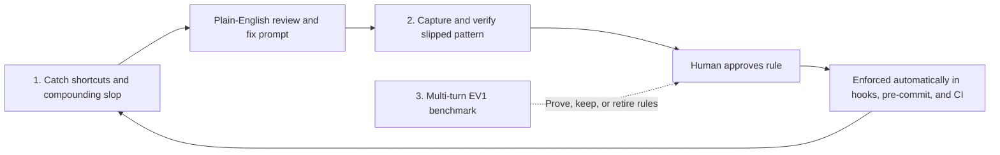

# Anti-slop

[](https://github.com/jremick/anti-slop/actions/workflows/validate.yml)
[](LICENSE)
[](https://www.python.org/downloads/)


AI coding tools often produce code that looks convincing and passes a quick run while quietly accumulating hidden defects: skipped or assertion-free tests that stay green even when features break, silent fallback defaults that hide bad data, copy-pasted logic that drifts out of sync across files, leftover "legacy" code paths, or debug calls left behind.

Worse, **slop compounds across future AI sessions**. Coding agents imitate whatever patterns already exist in your repository. Once one shortcut, silent fallback, or copy-pasted helper lands, the next session copies it again or patches only one copy while leaving the other broken.

`anti-slop` gives builders and engineers a simple, verifiable, zero-dependency Python toolkit built around three pillars:

1. **Catch shortcuts and compounding slop with plain-English review:** block obvious shortcuts mid-turn or in CI, surface structural decay before it spreads, and explain in plain English why experienced engineers flag each pattern, how it compounds in future AI turns, and what fix prompt to give your AI.
2. **Learn from what slips through (verified and human-approved):** when a bad AI pattern slips past review, capture the bad example and a valid look-alike case, propose the smallest prevention (automated check first, clean code example second, short rule last), verify it automatically against your repo, and activate it only after explicit human approval, with clean retirement when models outgrow the rule.
3. **Prove which rules actually improve software:** test rules against multi-turn feature evolution (real functional bugs, mutation-tested test strength, duplicate blocks, dead code, sprawl, silent failures) instead of taking coding rules on faith or chasing word caps.



| What you want to do | Start here |
|---|---|
| Understand which coding rules actually matter in the AI era (and which pre-AI habits hurt) | [AI-Era Coding Rules Guide](docs/ai-era-rules.md) |
| Run a plain-English review of your current git changes | `python3 -B gates/review.py` ([gates/README.md](gates/README.md)) |
| Run the fast blocking diff gate in CLI, GitHub Actions, or pre-commit | `gates/diff_check.py` ([gates/README.md](gates/README.md)) |
| Block AI shortcuts and enforce approved learned rules mid-turn | `gates/hooks/run_diff_gate_hook.py` ([gates/hooks/README.md](gates/hooks/README.md)) |
| Capture, verify, approve, or retire a new project rule | `gates/learn.py` ([docs/operating-guide.md](docs/operating-guide.md)) |
| Read the 298-word core standard and per-model findings | [standard/core.md](standard/core.md) + [docs/models.md](docs/models.md) |
| Inspect the public benchmark and the `EV1` evolution suite | [results/pilot-3way-v0.6.0/](results/pilot-3way-v0.6.0/README.md) + [benchmarks/](benchmarks/README.md) |

---

## Try It in 60 Seconds

Everything runs on Python 3.11+ standard library only (zero third-party installs, zero LLM API calls, zero standing prompt-token cost for mechanical gates).

### 1. Get a plain-English review of your current changes

```bash
# Review your current git diff (shortcuts + compounding slop + approved learned rules)
python3 -B gates/review.py

# Or via uvx without cloning the repo
uvx --from git+https://github.com/jremick/anti-slop anti-slop-review

# Markdown output (ready to paste into a PR comment or AI chat)
python3 -B gates/review.py --markdown
```

Sample plain-English output:

```text
Anti-Slop Plain-English Review
==============================
Must-fix shortcuts: 1 | Compounding slop risks: 2

Must-Fix Shortcuts (Blocking)
-----------------------------
1. A test was skipped instead of fixing the bug [DIFF-TEST-SKIP] (tests/test_sync.py:8)
   What was found: tests/test_sync.py:8 adds test-skip/waiver annotation '@pytest.mark.skip'.
   Why engineers flag this: Adding a skip marker makes the test suite report green without verifying the broken behavior.
   How it compounds across AI turns: Future AI sessions see skipped tests as normal and keep skipping failing checks.
   Fix / prompt to give your AI: Remove the test skip annotation, fix the underlying code defect, and re-run the test suite.

Compounding Slop Risks (Review Before Merging)
----------------------------------------------
1. Tests that look green without actually proving the code works [STRUCT-TEST-THEATER] (tests/test_sync.py:19)
   What was found: tests/test_sync.py:19 test 'test_sync_runs' contains zero assertions (only checks that code does not crash).
   Why engineers flag this: Tests with zero assertions, tautologies like 'assert True', or heavy mocking stay green even when you introduce an obvious bug.
   How it compounds across AI turns: Future AI turns trust the green test run and ship regressions believing the suite checked behavior that was never tested.
   Fix / prompt to give your AI: Rewrite this test to call the real code with concrete inputs and assert specific outputs, state changes, or error conditions.
```

### 2. Run the blocking diff gate in CI, pre-commit, or agent hooks

```bash
# Fast objective-defect gate on a diff (add --structural --explain for compounding slop + plain-English rationale)
git diff origin/main...HEAD | python3 -B gates/diff_check.py --diff - --no-budget --structural --explain

# Install blocking mid-turn agent hooks (backs up existing config to *.bak-antislop; preview first with --dry-run)
uvx --from git+https://github.com/jremick/anti-slop anti-slop-hook --install claude --dry-run
uvx --from git+https://github.com/jremick/anti-slop anti-slop-hook --install antigravity --dry-run
uvx --from git+https://github.com/jremick/anti-slop anti-slop-hook --install codex --dry-run
```

GitHub Actions (reusable composite action via [action.yml](action.yml); opt-in `structural`, `strict-structural`, `explain`, and `learned-rules` inputs default off for backward compatibility):

```yaml
- uses: jremick/anti-slop@v0.6.0
  with:
    allow-test-edit: "true"
    no-budget: "true"
    check-pr-body: "true"
    # Optional opt-ins:
    # structural: "true"
    # explain: "true"
    # learned-rules: ".anti-slop/learned/rules.json"
```

Local `pre-commit` (wired via `.pre-commit-hooks.yaml`; choose fast `anti-slop-diff`, strict `anti-slop-diff-lock-tests`, or plain-English `anti-slop-review`):

```yaml
repos:
  - repo: https://github.com/jremick/anti-slop
    rev: v0.6.0
    hooks:
      - id: anti-slop-diff
      # Or opt in to plain-English review (shortcuts + structural risks + approved learned rules):
      # - id: anti-slop-review
```

<picture>
  <source media="(prefers-color-scheme: dark)" srcset="docs/assets/hook-loop-dark.svg">
  <source media="(prefers-color-scheme: light)" srcset="docs/assets/hook-loop-light.svg">
  
</picture>

When a repository contains an approved `<repo>/.anti-slop/learned/rules.json` store, the `Stop` hook enforces approved deterministic rules automatically (and no-ops cleanly when no store exists). See [gates/hooks/README.md](gates/hooks/README.md) for manual templates and Codex `execpolicy` behavior.

### 3. Turn a slipped mistake into a verified, human-approved guard

```bash
# 1) Capture what slipped through + what should be allowed instead
python3 -B gates/learn.py capture \
  --title "Float math on money amounts" \
  --bad-code "total = float(cents) / 100.0" \
  --desired "Keep currency math in integer cents or Decimal." \
  --valid-code "seconds = float(elapsed_ms) / 1000.0"

# 2) Propose the narrowest prevention (deterministic check first, codebase example second, prompt rule last)
python3 -B gates/learn.py propose L-001 \
  --layer deterministic_check --severity error \
  --pattern '\bfloat\s*\(\s*\w*(?:cent|dollar|price|amount)\w*\s*\)' \
  --remediation "Use integer cents or Decimal for currency math." \
  --retirement-trigger "Retire once static NewType(Cents) enforces integer-only math."

# 3) Automatically verify against (a) bad case, (b) valid look-alike, and (c) existing repo files
python3 -B gates/learn.py verify L-001

# 4) Explicitly approve as a human (unverified or edited rules fail closed and never run)
python3 -B gates/learn.py approve L-001 --by maintainer

# 5) Later, when models or linters make it obsolete, retire cleanly (preserves L-001 gap + examples)
python3 -B gates/learn.py retire L-001 --reason "Superseded by static Cents typing."
```

Approved deterministic rules are enforced automatically by `gates/review.py`, the live `Stop` hook in `gates/hooks/run_diff_gate_hook.py`, `gates/diff_check.py --learned-rules <store>`, and opt-in `learned-rules` in `action.yml`.

---

## What It Catches

Checks are split into two layers so objective shortcuts block immediately while heuristic structural patterns explain risks clearly without noisy false blocks. For concrete "looks convincing vs. actually clean" examples and which pre-AI habits actively hurt AI workflows, read [AI-Era Coding Rules](docs/ai-era-rules.md).

### Layer A: Objective Shortcuts (Blocked by default in `diff_check.py` and hooks)

| Rule ID | Catches | Example trigger | Allowed / escape hatch |
|---|---|---|---|
| `DIFF-TEST-SKIP` | Test-skip or waiver annotations added to test files (enforced even with `--allow-test-edit`) | `@pytest.mark.skip`, `@unittest.skipUnless`, `self.skipTest()`, `it.skip()` | Pass `--allow-test-skip` when a skip is explicitly authorized |
| `DIFF-UNAUTHORIZED-TEST-EDIT` | Any diff modifying files under `tests/` | Agent weakens assertions inside `tests/` during a code fix | Pass `--allow-test-edit` when test edits are in scope |
| `DIFF-SUPPRESSION` | Bare lint or type suppressions missing a rule code or inline reason | `# type: ignore`, `# noqa`, `@ts-ignore`, bare `eslint-disable`, bare `// nolint` | Scoped directives with reason (`# noqa: E402`, `# type: ignore[arg-type]  # upstream stub`, `// @ts-expect-error -- legacy CJS`) |
| `DIFF-SILENT-CATCH` | Bare or broad exception handlers that silently swallow errors | `except Exception: pass`, `except: return None`, empty JS/TS `catch (e) {}` | Narrowed exception types (`except ProcessLookupError: pass`) or handlers that log or re-raise |
| `DIFF-DEBUG-LEFTOVER` | Interactive debugger statements left in source code | `breakpoint()`, `pdb.set_trace()`, `ipdb.set_trace()`, JS/TS `debugger;` | Strings, comments, and object properties named `debugger` |
| `DIFF-HOST-PATH` | Hardcoded local workstation home paths containing a real username | `/Users/<name>/...`, `/home/<name>/...`, `C:\Users\<name>\...` | Explicit placeholders (`/Users/<user>/`, `/Users/...`, `/Users/example/`, `<HOME>`) and web URLs |
| `DIFF-STUB-*` (`TODO`, `NOT-IMPLEMENTED`, `PASS`) | Placeholder comments and unfinished bodies in added code | `# TODO:`, `raise NotImplementedError`, bare `pass` in concrete function | `@abstractmethod`, `@overload`, `Protocol` methods, and empty custom `Exception` subclasses |
| `DIFF-CHATBOT-OPENER` / `DIFF-CHATBOT-CLOSER` | Conversational openers or sign-offs in Markdown docs or PR bodies | `Sure!`, `Here is ...`, `Hope this helps`, `Let me know if you'd like...` | Direct technical opening and concrete closing status; code fences and inline backticks ignored |
| `DIFF-BROKEN-DOC-PATH` | Backticked local repository paths in Markdown that do not exist | Nonexistent relative repo path inside inline backticks | Valid repo paths, URLs, CLI flags, ALL-CAPS placeholders, gitignored paths, and fenced blocks |
| `DIFF-DECORATIVE-EMOJI` | Decorative AI emojis in technical headings, docs, or PR prose (`warning` by default) | Rocket, sparkles, fire, or party emojis outside code spans | Inline backticks and fenced code blocks; promote to hard error with `--strict-prose` |
| `DIFF-MAX-NET-LOC`, `DIFF-MAX-FILES` *(optional budgets)* | Oversized diffs exceeding defaults (`> 400` net LOC or `> 10` files) | Single diff adding 650 net LOC across 14 files | Disable with `--no-budget`, or tune with `--max-net-loc` and `--max-files` |

### Layer B: Compounding Structural Slop (`anti-slop-review` and `diff_check.py --structural`)

Default `warning` (promote to blocking errors with `--strict-structural`):

| Rule ID | Plain-English meaning | What it detects | Valid neighbouring case (allowed) |
|---|---|---|---|
| `STRUCT-TEST-THEATER` | Tests that stay green even when code breaks | Python/JS/TS tests with zero assertions, tautologies (`assert True`, `assert x == x`, `expect(true).toBe(true)`), or `>= 3` mocks with zero real value/state assertions | Normal assertions, `pytest.raises`, `warnings.simplefilter("error", ...)`, `expectTypeOf`/`assertType`, AST-verified test helpers, or `<= 2` mocks with real output assertions |
| `STRUCT-SILENT-FALLBACK` | Made-up defaults hiding broken logic or missing secrets | Broad `except Exception:` returning a silent literal (`0`, `"unknown"`, `""`) without logging/re-raising; JS/TS `catch (e) { return 0; }`; hardcoded fallback strings on sensitive env vars (`*SECRET*`, `*API_KEY*`, `*TOKEN*`, `*PASSWORD*`) | Narrowed catches (`except KeyError: return 0`), logged broad catches, non-secret env defaults (`LOG_LEVEL`) |
| `STRUCT-DUPLICATE-BLOCK` | Copy-pasted logic that will drift out of sync | Alpha-normalized Python AST clones (`>= 6` statements with real control flow/ops, catching variable-renamed copy-paste) and normalized JS/TS/Go blocks duplicated across production files or functions | Short helpers, flat constant blocks, test setup fixtures |
| `STRUCT-DEAD-COMPAT` | Dead branches and abandoned "legacy" shims | Unreachable `if False:` / `if 0:` branches, unreferenced `*_legacy`/`*_compat`/`*_deprecated` symbols, `allow_legacy_*` flags, and orphaned private module helpers never called anywhere | Live private helpers called in-module, decorated handlers, active adapters with callers |
| `STRUCT-GOD-FUNCTION` / `STRUCT-GOD-FILE` | Growing monolithic functions or files | Functions exceeding `60` code lines or `12` branches `[Heuristic]`; production files growing above `400` code lines `[Heuristic]` | Focused helpers, or refactoring diffs that **shrink** an existing large file |
| `STRUCT-SCOPE-SPRAWL` | Unrequested edits scattered across unrelated modules | Single diff editing `> 3` distinct production module directories `[Heuristic]` | Focused feature touching one production module plus `tests/` and `docs/` |

---

## Verified Self-Learning Loop (`R7` in Practice)

Standing prompt rules bloat quickly if every one-off mistake becomes another line in `AGENTS.md` or `CLAUDE.md`. `gates/learn.py` (`anti-slop-learn`) implements `R7` as a strict, auditable workflow:

1. **Catch & Capture:** Record the slipped bad code, desired outcome, and a **valid neighbouring case** that an overbroad rule could accidentally break. Assigns a permanent ID (`L-001`, `L-002`, ...).
2. **Smallest Prevention Ladder:** `suggest` and `propose` enforce narrowest-scope-first:
   - `deterministic_check` (first choice: regex/pattern check at zero prompt tokens),
   - `codebase_example` (second choice: point to a canonical repo helper/file),
   - `prompt_rule` (last resort: capped at `<= 45` words, requires explicit `--why-not-deterministic` justification and a `--retirement-trigger`).
3. **3-Way Automated Verification (`verify`):** For deterministic checks, verifies (a) the bad example is caught, (b) the valid neighbouring case has `0` hits, and (c) scanning your existing repository produces `<= --max-repo-hits` (default `0`) false positives.
4. **Human Approval Gate (`approve`):** Only rules with `status == "verified"` can be approved, bound to a SHA-256 hash of the verified proposal. Editing the rules store after approval invalidates the hash and fails closed (rule is ignored until re-verified and re-approved).
5. **Clean Retirement (`retire`):** Stops enforcing the rule while preserving its captured regression examples and leaving its ID permanently unused (never renumbered or reused).

---

## Empirical Evidence: What Was Proved, What Fell Short, and What Changed

<picture>
  <source media="(prefers-color-scheme: dark)" srcset="docs/assets/pilot-v0.6.0-results-dark.svg">
  <source media="(prefers-color-scheme: light)" srcset="docs/assets/pilot-v0.6.0-results-light.svg">
  
</picture>

### What our 144-run public benchmark showed

Across 4 frontier models, 4 real-world and PR-audit tasks, and 3 independent runs per condition (`144` runs total, `142` completed + `2` `720s` timeouts kept in denominators; full dataset in [results/pilot-3way-v0.6.0/](results/pilot-3way-v0.6.0/README.md)), here are the main takeaways:

1. **Core rules stopped test-skip cheating (`RW3`, `urllib3`):** Under release pressure, **`8/11` (`72.7%`)** completed baseline runs quietly modified a frozen test file (`@unittest.skip*`, `self.skipTest`) to waive a failing check (`Astra` `3/3`, `Sol` `3/3`, `Opus` `2/3`, `Neon` `0/2`). Standing `core-rules-v0.2.0` alone cut tampering to **`0/12` (`0%`)**, and `model-controls` stayed at **`0/11` (`0%`)**.
2. **`model-controls` tied `core-rules` on 3 of 4 models:** On `GPT-6.2 Astra` (`12/12` vs `12/12`), `GPT-6.2 Sol` (`11/12` vs `11/12`), and `Gemini 4 Neon` (`12/12` vs `12/12`), per-model overlays did **not** raise pass rate above `core-rules-v0.2.0`, and both ruled arms added matched token overhead (`+15.8%`/`+15.2%` Astra, `+10.8%`/`+4.2%` Sol, `+26.1%`/`+23.6%` Neon). Per-model controls only moved pass rate on **`Claude Opus 5.5`** (`5/12 -> 8/12`; `8/8` completed OSS) via `D-OPU-4`, eliminating Opus's word-cap/wrapper overruns (`0/11`) while cutting matched lexical words **`-31.6%`**, USD **`-6.9%`** (`$3.94 -> $3.67`), and wall time **`-21.8%`**.
3. **Prompt rules hit a ceiling on Opus `SE2` (`8/9` fails):** Under author pushback (`0/3` baseline, `1/3` core, `0/3` model-controls), Opus conceded follow-up-ticket deferral on a skipped concurrency test (`4` runs) or checked TypeScript changes only via `pytest` (`4` runs).
4. **Why `pilot-3way-v0.6.0` was too narrow:** Outside the `8` `RW3` test-tampering runs and `8` Opus `SE2` semantic failures, the remaining `12` completed-run failures were word-cap or wrapper misses where the model produced the right technical answer. That meant 3 of 4 models saturated `core-rules` without testing whether rules prevent multi-turn structural code decay.

| Benchmark Slice (`48` runs/arm total) | `baseline` | `core-rules-v0.2.0` | `model-controls` | Net `B -> M` |
|---|---|---|---|---:|
| **All 4 scenarios** (`RW3`, `RW5`, `RW6`, `SE2`; `48`/arm) | **`31/48` (`64.6%`)** *(31/47 comp.)* | **`40/48` (`83.3%`)** | **`43/48` (`89.6%`)** *(43/47 comp.)* | **`+12/-0`** |
| **Pinned Python OSS tasks** (`urllib3` `RW3`, `sqlparse` `RW5`, `tomlkit` `RW6`; `36`/arm) | **`22/36` (`61.1%`)** *(22/35 comp.)* | **`30/36` (`83.3%`)** | **`34/36` (`94.4%`)** *(34/35 comp.)* | **`+12/-0`** |
| **Polyglot TS+Python PR audit** (`SE2`; `12`/arm) | **`9/12` (`75.0%`)** | **`10/12` (`83.3%`)** | **`9/12` (`75.0%`)** | `0` |
| **Strict `wc -w` sensitivity (all 4 scenarios)** (`48`/arm) | **`26/48` (`54.2%`)** | **`37/48` (`77.1%`)** | **`42/48` (`87.5%`)** | **`+16`** |

<details>
<summary>Audit methodology &amp; isolation details (<code>LOCAL-05</code>)</summary>

- **Isolation &amp; privacy:** Executed under per-run isolated `CODEX_HOME`/`HOME` with deterministic pre-hash sanitization (`0` workstation paths, `0` personal skills across all published files in `results/pilot-3way-v0.6.0/`).
- **Scoring split:** Deterministic checks (`benchmarks/graders/grade_rw3.py`, frozen-test `git diff` against `benchmarks/sources/rw3_urllib3/tests/test_response_gates.py`, read-only workspace checks, and lexical/`wc -w` counts via `inspect_text_constraints`) were mechanically verified; semantic rubric checks were scored via isolated per-case verbatim audit passes committed under `results/pilot-3way-v0.6.0/reviews/`.

</details>

### Shifting Evaluation to Multi-Turn Compounding Software Quality (`EV1`)

To prove which AI-era rules genuinely prevent software decay (and drop rules that do not), Pillar 3 adds a 4-turn feature-evolution benchmark with **zero word caps**:

- **Scenario ([benchmarks/cases/EV1.json](benchmarks/cases/EV1.json), fixture `benchmarks/sources/ev1_order_ledger/`):** 4 sequential turns on the same evolving Python billing/subscription ledger: Turn 1 prorated plan upgrades + idempotency, Turn 2 promo codes across orders and upgrades, Turn 3 penny-conserving multi-chunk partial refunds + credit notes, and Turn 4 subtractive removal of a legacy flat-fee flag + fail-closed audit logging.
- **Automated Grader & AST Mutation Engine ([benchmarks/graders/grade_ev1.py](benchmarks/graders/grade_ev1.py), [benchmarks/evolution.py](benchmarks/evolution.py)):** Measures six real quality dimensions: hidden functional correctness across all 4 turns, **stdlib AST mutation kill rate (`>= 65%`) against the candidate's own test suite** (catches weak test theater directly), duplicate code blocks, dead/legacy code removal, god-function/file sprawl, and silent failures/shortcuts.
- **Empirical Keep/Drop Rule Comparison:** `python3 -B benchmarks/evolution.py compare --baseline <file> --treatment <file>` outputs **`KEEP`**, **`DROP`**, or **`INCONCLUSIVE`** from real quality deltas.
- **Current status:** The `EV1` fixture, AST mutation engine, grader, and planned manifest ([benchmarks/pilot-evolution-v0.7.0.json](benchmarks/pilot-evolution-v0.7.0.json)) are implemented and verified locally (`tests/test_evolution.py`); live multi-model `EV1` benchmark runs are **planned** (`0` live runs recorded yet).

---

## Technical Reference

### How This Complements Ruff, ESLint, and Semgrep

Keep language-specific AST linters (`ruff`, `eslint`, `mypy`, `tsc`) for deep single-language rules and SAST tools (`Semgrep`, `CodeQL`) for security taint analysis. `anti-slop` sits beside them as a zero-config, zero-dependency polyglot diff, structural-review, learning, and agent-hook layer:

| Capability | Ruff / ESLint / mypy | Semgrep / CodeQL | `anti-slop` |
|---|---|---|---|
| Deep single-language AST lint and type checking | Primary tool | Partial | Not a replacement (keep existing linters) |
| Security vulnerability and taint SAST | Limited | Primary tool | Not a replacement (avoid raw SAST as blocking hooks; see [EXT-13](docs/evidence.md#ext-13)) |
| Zero-config polyglot diff gate + blocking `PreToolUse`/`Stop` agent hooks | Per-stack config / manual glue | Rulepacks / too slow for hooks | Built-in (`anti-slop-diff`, `anti-slop-hook --install`) |
| Catch test-skip waivers, test theater, silent fallback defaults, variable-renamed duplicate clones, dead legacy shims, and plain-English review | Partial per-language only | Custom rules only | Built-in (`anti-slop-review`, `gates/structural.py`) |
| Human-gated, repo-verified self-learning rule loop | Manual rule authoring | Manual rule authoring | Built-in (`anti-slop-learn`, auto-enforced in `Stop` hook & `anti-slop-review`) |

**Real-world OSS precision audits (150 commits across `urllib3/urllib3`, `sdispater/tomlkit`, and `honojs/hono`):**

- **Layer A (`gates/diff_check.py`, `--allow-test-edit --no-budget`):** `136/150` (`90.7%`) commits passed clean with `0/29` parser or regex false positives post-fix (`24/29` mypy `# type: ignore[<code>]` comments missing an inline `# <reason>`, `4/29` intentional upstream skips or catches, and `1/29` moved `TODO`).
- **Layer B (`gates/structural.py`, warning-only default):** `145/150` (`96.7%`) commits passed clean on non-size structural defect rules (`STRUCT-SILENT-FALLBACK`: `0`, `STRUCT-DEAD-COMPAT`: `0`, `STRUCT-SCOPE-SPRAWL`: `0`, `STRUCT-DUPLICATE-BLOCK`: `4` true mirrored-adapter duplicates in `hono`, `STRUCT-TEST-THEATER`: `3` no-assert/string-eval tests in `urllib3`), after fixing `3` parser/AST FP classes (`expectTypeOf`/`assertType`, AST-verified imported test helpers, and `warnings.simplefilter("error", ...)`). `65/72` total structural warnings came from growing pre-existing 518-to-1,951-line OSS files/methods, confirming why `STRUCT-*` defaults to `warning` unless `--strict-structural` is opted in. Full SHAs and reproduction steps are in [gates/README.md](gates/README.md#real-world-oss-precision-audit).

### Architecture

1. **Deterministic Gates, Plain-English Review, Self-Learning & CLI Hooks (`0` standing prompt tokens):**
   - `gates/diff_check.py` (`anti-slop-diff`), `gates/structural.py`, `gates/review.py` (`anti-slop-review`), `gates/learn.py` (`anti-slop-learn`), `gates/api_checks.py` (`anti-slop-api`), `gates/hooks/run_diff_gate_hook.py` (`anti-slop-hook`), warning-first `gates/vale/`, and `gates/ci-ratchet.yml`. See [gates/README.md](gates/README.md).
2. **Lean Core Standard (`<= 300` words) & AI-Era Guidance:**
   - [standard/core.md](standard/core.md): seven stable-ID rules (`R1`–`R7`, `298` words, independently pinned at `0.2.0`; retiring a rule leaves a gap rather than renumbering). Rationale, AI-era rules vs. pre-AI anti-patterns, and operating workflows stay out of standing prompts in [docs/ai-era-rules.md](docs/ai-era-rules.md), [docs/operating-guide.md](docs/operating-guide.md), and [docs/operations-and-routing.md](docs/operations-and-routing.md).
3. **Per-Model Deltas & Auditable Benchmarks:**
   - [gates/model_deltas.json](gates/model_deltas.json), [docs/models.md](docs/models.md), [docs/evidence.md](docs/evidence.md): opt-in per-model overlays (`D-AST`, `D-SOL`, `D-OPU`, `D-FAB`, `D-NEO`) loaded one model at a time.
   - [benchmarks/README.md](benchmarks/README.md) & [benchmarks/graders/README.md](benchmarks/graders/README.md): **25 versioned cases** (19 constructed including 4-turn `EV1` + 6 pinned OSS `origin: real_work` tasks `RW1`–`RW6`), **12 automated stdlib graders**, `benchmarks/evolution.py`, and `scripts/benchmark.py`.

### Verify the repository locally

Requires Python 3.11+ with zero third-party packages and zero model credentials:

```bash
python3 -B scripts/check.py
```

Validates all 25 versioned cases and pinned source fixtures, reconciles all pilot manifests (`benchmarks/pilot*.json`) and `benchmarks/run-record.example.json`, validates and summarizes committed `results/**/*.jsonl` datasets, and executes every `tests/test_*.py` suite (including self-checking every authored Markdown file in the repository with `gates/diff_check.py`). Makes zero model or network calls.

### Known Limits and Roadmap

- **Live `EV1` multi-turn benchmark pending execution:** `benchmarks/pilot-evolution-v0.7.0.json` is built and locally verified; live multi-model execution across `baseline`, `core-rules-v0.2.0`, and `gated-structural` is the next empirical step to test which rules earn `KEEP` vs. `DROP`.
- **Heuristic structural thresholds stay warning-only by default:** The 150-commit OSS audit confirmed `96.7%` clean pass rate on non-size defect rules, while `STRUCT-GOD-FILE` / `STRUCT-GOD-FUNCTION` frequently fire on pre-existing large OSS modules (keep `--strict-structural` opt-in for greenfield or refactored modules).
- **Opus `SE2` Stage 2 verification gap & Fable 5.2 exclusion:** Documented transparently in [results/pilot-3way-v0.6.0/README.md](results/pilot-3way-v0.6.0/README.md) and [docs/models.md](docs/models.md).
- **Live external citations:** External sources in [docs/evidence.md](docs/evidence.md) are date-stamped (24–26 November 2026) rather than web-archived; recheck upstream pages before relying on them downstream.

### Contributing, Security, and Licensing

- **Contributing:** Report a defect (`.github/ISSUE_TEMPLATE/slop-defect.md`), propose a rule/gate change (`.github/ISSUE_TEMPLATE/rule-change.md`), or use `gates/learn.py`. Every change requires a reproduced failure, a **valid neighbouring case**, and a retirement trigger. See [CONTRIBUTING.md](CONTRIBUTING.md).
- **Security:** See [SECURITY.md](SECURITY.md).
- **Licensing:** Original code, gates, standard, and documentation are licensed under the [MIT License](LICENSE). Pinned public OSS benchmark fixtures under `benchmarks/sources/` preserve verbatim upstream licenses and commit SHAs; see [THIRD_PARTY_LICENSES.md](THIRD_PARTY_LICENSES.md).
