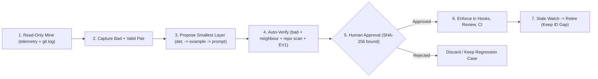

# Continuous Evals, Self-Learning, and Model Onboarding

Static rule sets go stale as codebases change and new frontier models drop. Rules that once prevented real regressions can become dead weight, while newly emerging failure modes slip past older checks.

This guide defines the repeatable operating loop that keeps `anti-slop` grounded in evidence: local telemetry and git mining, automated 3-way verification, objective multi-turn keep/drop decisions, repeatable onboarding for new models, and explicit rule retirement. Keep this document outside standing prompts (`standard/core.md` remains pinned at `<= 300` words).

## 1. Continuous Self-Learning and Autoresearch Ratchet (Human-Approved)

The self-learning loop in `gates/learn.py` follows a strict ratchet: **mine -> capture -> propose -> verify -> human approve -> enforce -> retire**. Every candidate rule must prove it catches a real failure without breaking valid code or bloating prompts, and no agent may self-approve a rule.



### Step A: Read-Only Continuous Mining (`anti-slop learn mine`)

Run read-only pattern mining periodically or on demand:

```bash
python3 -B gates/learn.py mine --repo-root . --commits 30 --stale-days 60
# Or via the unified CLI in JSON mode for agent workflows:
anti-slop learn mine --json
```

`mine` combines two read-only local signals without modifying `<repo>/.anti-slop/learned/rules.json`:

1. **Opt-in local hook and review telemetry (`<repo>/.anti-slop/telemetry.jsonl`):** Records only timestamps, event types (`stop_hook`, `pretool_hook`, `review`), harness names, `blocked` booleans, rule codes, and file extensions (zero source snippets, secrets, or workstation paths; ignored via `.gitignore`). `mine` skips malformed lines safely, aggregates rule counts, flags recurring patterns (`count >= 2`), and checks active approved `L-*` rules for zero-hit staleness past `--stale-days`.
2. **Recent non-merge git history (`--commits N`):** Scans newly added lines across the last `N` non-merge commits against all uninstalled deterministic `OPT-*` rules in `library/catalog.json` to recommend relevant optional packs with exact commit counts and sample SHAs. It also scans recent commit diffs for recurring `DIFF-*` and `STRUCT-*` patterns plus `fix:` / `revert` churn signals.

### Step B: Narrowest-Layer Escalation and 3-Way Verification

Before asking a human reviewer to approve any candidate surfaced by `mine` or a code review:

1. **Check the curated library first:** Inspect and dry-run verify a matching optional pack before inventing a custom regex (`anti-slop learn library show <pack>` and `anti-slop learn library enable <pack> --by <human> --dry-run`).
2. **Escalate from narrowest to broadest layer:** Prefer `deterministic_check` (zero standing prompt tokens) first, `codebase_example` second, and a scoped `<= 45`-word `prompt_rule` last (requiring explicit `--why-not-deterministic` and `--retirement-trigger`).
3. **Pass 3-way automated verification (`anti-slop learn verify <id>`):** Every deterministic candidate must (a) catch its captured `bad_example`, (b) leave its `valid_neighbouring_case` untouched, and (c) pass an existing-repository false-positive scan (`repo_scan_hits <= max_repo_hits`). Any candidate that fails is fixed or discarded automatically before reaching a human.
4. **Prove prompt-layer rules empirically:** Any candidate that cannot be enforced deterministically must prove net quality gain via paired multi-turn `EV1` comparison (`benchmarks/evolution.py compare` returning `KEEP`) rather than intuition.
5. **Require explicit human approval:** Enforcement activates only after a human runs `anti-slop learn approve <id> --by <name>`. Approval binds a SHA-256 hash of the verified proposal; editing a rule after approval fails closed until re-verified and re-approved.

## 2. Onboarding New Frontier Models

Whenever a new frontier model releases, measure it in isolation before writing a single model-specific rule. Do not assume an older model's failure modes still exist, and do not copy deltas from a previous generation without testing baseline first.

### Step-by-Step Protocol

1. **Generate the exact isolated run plan and stage budget:**

```bash
python3 -B scripts/eval_cycle.py plan \
  --model <provider>:<model_id> \
  --suites all \
  --replicates 3
```

Use `--suites evolution`, `--suites comments`, or `--suites integrity` to stage suites incrementally, or `--json` for automated orchestration.

2. **Register the model adapter cleanly:** Add the model entry to `DEFAULT_MODELS` and `FROZEN_MODEL_VERSIONS` in `scripts/run_benchmark.py`. Keep `gates/model_deltas.json` untouched on the first pass so `baseline` and `core-rules-v0.2.0` are measured without speculative model deltas.
3. **Dry-run and verify isolation:** Run each planned `--dry-run` command first to verify condition hashes, stage counts, and model routing with zero API spend. Confirm every run executes in a fresh temp directory outside the repository with isolated `CODEX_HOME`/`HOME`, `ANTI_SLOP_BENCHMARK_SUBJECT=1`, and pre-hash path sanitization.
4. **Execute the isolated suites into `runs-local/`:** Run the generated `scripts/run_benchmark.py` commands (with `--resume` and `--child-max-rss-mb 1536`). Keep all timeouts, blocked attempts, and failures inside `runs.jsonl` denominators with hashed blocker evidence.
5. **Grade, validate, and compute keep/drop decisions:**
   - Validate hashes and schema with `scripts/benchmark.py validate`.
   - Summarize paired tracks with `scripts/benchmark.py summarize` and confirm `missing_pilot_coverage.complete = true` against a matching pilot manifest under `benchmarks/`.
   - For `EV1`, run `benchmarks/evolution.py compare` on Stage-4 grader metrics to classify each arm (`KEEP`, `DROP`, or `INCONCLUSIVE`).
6. **Promote clean results and refresh the longitudinal scorecard:** Move sanitized datasets from `runs-local/` into `results/<experiment-id>/`, update the scorecard, and run all repository integrity checks:

```bash
python3 -B scripts/eval_cycle.py scorecard --markdown
python3 -B scripts/check.py
```

7. **Add model deltas only for verified recurring defects:** Add an entry in `gates/model_deltas.json` only if baseline and `core-rules-v0.2.0` exhibit a concrete, recurring model-specific defect that deterministic gates cannot catch directly, backed by a falsification check and a valid neighbouring case.

## 3. Rule Retirement Discipline

Accumulating rules indefinitely slows reviews, raises token overhead, and triggers false-positive churn. Treat every standing rule (`R1`-`R7`), model delta (`D-*`), and learned rule (`L-*`) as code with an explicit retirement path.

### Two Retirement Signals

1. **Project-level staleness (`anti-slop learn mine --stale-days 60`):** Any approved `L-*` rule with zero hits across the `--stale-days` window (or whose recorded `retirement_trigger` is now satisfied by a linter, static type, or framework upgrade) is surfaced under `retirement_candidates`. Retire it with:

```bash
python3 -B gates/learn.py retire L-001 --reason "Enforced by static type check in CI."
```

2. **Benchmark-level ceilings and regressions (`scripts/eval_cycle.py scorecard`):** The scorecard's **Rule-Retirement Watch** highlights two conditions automatically:
   - **Baseline 100% ceiling across all tested models:** For example, in `results/pilot-comments-v0.7.0/` (`CM1`), the `no-comments` baseline already passes `12/12` (`100.0%`) across all four focus models on accuracy (while `comment-traps` still adds a `+26.8%` wall-time tax). Accuracy-only rules targeting that explicit single-file prompt have no headroom left; retire them or upgrade the benchmark to a harder multi-file case (`CM2`).
   - **Treatment regression or `DROP` verdicts:** In `results/pilot-evolution-v0.7.0/` (`EV1`), standing prose (`core-rules-v0.2.0`) dropped overall pass rate from `6/12` (`50.0%`) to `5/12` (`41.7%`) and triggered `DROP` on `claude-opus-5-5` and `gpt-6.2-sol`, whereas deterministic + structural gating (`gated-structural`) reached `11/12` (`91.7%`) with `0` slop defects. That result directly justifies moving enforcement from standing prose into deterministic gates rather than expanding `standard/core.md`.

### Stable ID Invariant

Retiring any rule (`R*`, `D-*`, or `L-*`) stops its enforcement while keeping its regression examples in the repository and leaving its ID permanently unused. Never renumber or reuse retired IDs; if a future model regresses on a previously retired failure mode, the preserved bad/valid pair catches it cleanly.

## 4. Roadmap Beyond Pre-v1 (`0.7.0` -> `1.0.0`)

Release `0.7.0` is a pre-v1 milestone: deterministic diff and structural gates, diff-scoped Python AST mutation testing (`gates/mutate.py`), the human-gated learning loop (`gates/learn.py`), and `216` clean `CODEX_HOME`-isolated public runs (`results/`) are working today, while broader verification and multi-language coverage remain active milestones toward `1.0.0`.

Planned post-`0.7.0` priorities, ordered by impact:

1. **Live E2E and real-artifact verification automation:** Automate Tier-1 verification workflows that start the real app, HTTP API, CLI, or browser against real inputs and capture observable exit codes, responses, state changes, or screenshots rather than relying on heavily mocked unit tests alone (see the 3-tier verification hierarchy in [docs/operating-guide.md](operating-guide.md#3-tier-verification-hierarchy)).
2. **Architectural slop detection:** Extend `gates/structural.py` beyond file-level checks to catch cross-module coupling spikes, single-implementation factory/interface/DI wrapper bloat, and leaky boundary abstractions across diffs.
3. **Broader language and multi-file evaluations:**
   - **`EV2` (TypeScript/JavaScript multi-turn evolution):** Replicate multi-turn compounding decay measurements outside Python.
   - **`CM2` (harder multi-file comment ablation):** Hide domain invariants across interacting files without naming them in the prompt so brief `# INVARIANT:` notes vs. stale comment traps are tested without accuracy ceiling compression.
   - **JS/TS AST mutation testing:** Extend diff-scoped mutation testing beyond Python (`gates/mutate.py`) to TypeScript and JavaScript diffs.
4. **Scheduled cross-model re-evaluations and automated retirement reviews:** Run `scripts/eval_cycle.py plan` and `scorecard` on a recurring cadence as new frontier models release, retiring rules that models outgrow and updating `gates/model_deltas.json` strictly from measured clean datasets.
